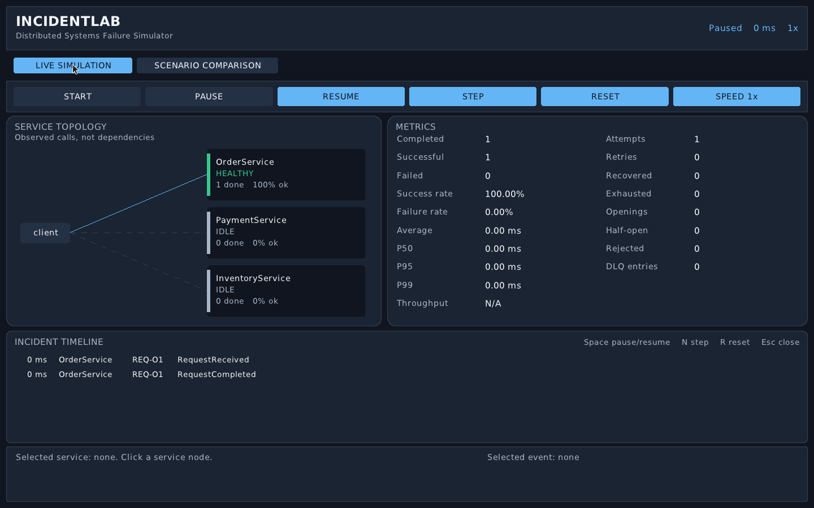
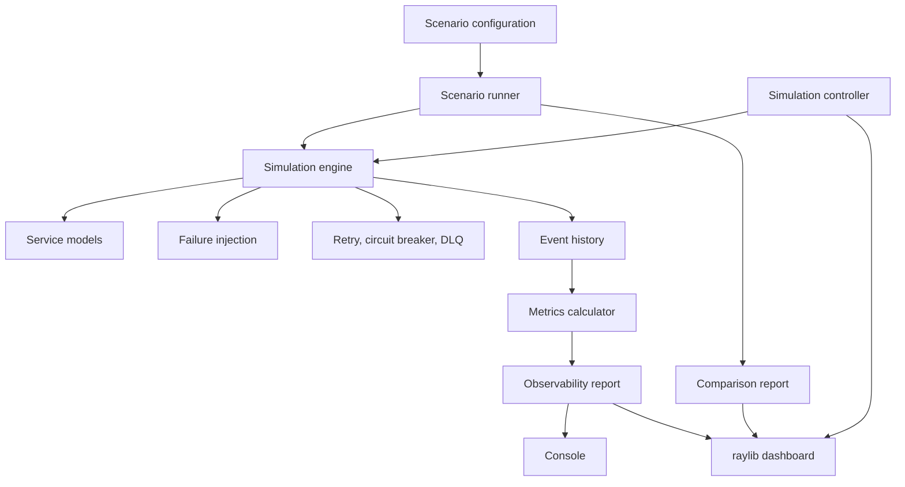
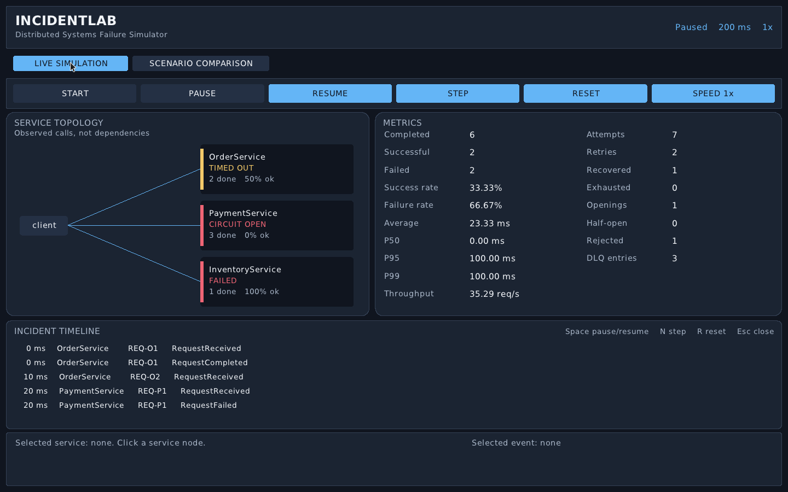
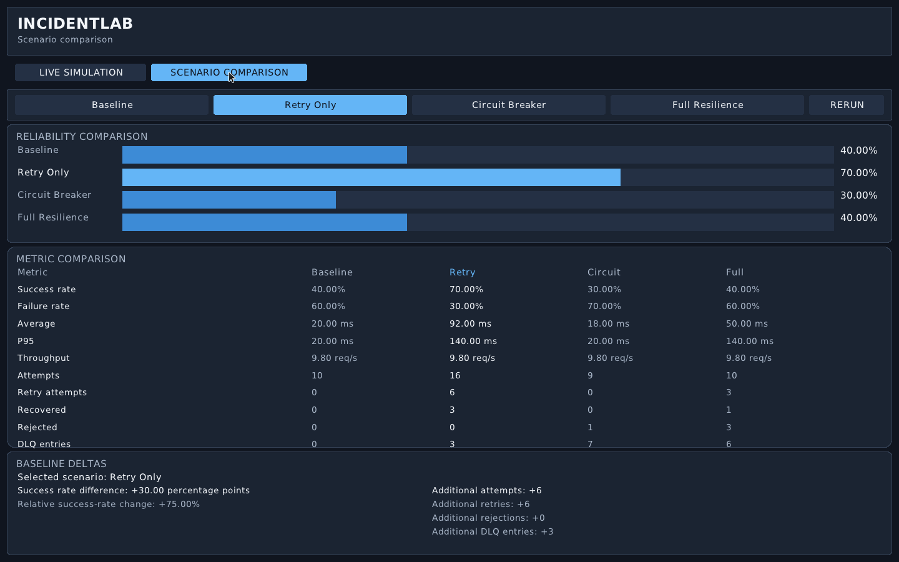

# IncidentLab
### Distributed Systems Failure Simulator

IncidentLab is a deterministic C++17 simulator for exploring how a small set of services behaves when calls fail, and how retry, a circuit breaker, and a dead-letter queue change the outcome. The simulation uses virtual time. It does not open sockets, deploy services, or depend on a cloud provider.

The same engine drives a console report, an optional raylib dashboard, and a comparison of four resilience strategies. Automated tests and GitHub Actions check the headless build.



## Key features

- Discrete-event simulation on a virtual clock
- Service, request, and event models, with `Service::handle` as the call boundary
- Failure injection: service failure, slow response, timeout, and dropped request
- Retry with exponential backoff, a per-service circuit breaker, and an in-memory dead-letter queue
- Metrics: rates, latency percentiles, throughput, retries, circuit activity, and an incident timeline
- Optional raylib dashboard for playback, topology, metrics, and the timeline
- Comparison of Baseline, Retry Only, Circuit Breaker, and Full Resilience on one workload
- CTest suites, AddressSanitizer, UndefinedBehaviorSanitizer, `gcov` coverage, and GitHub Actions

## Architecture

`incidentlab_core` owns the model and the engine. The console and the window only present results. Tests call the core directly and do not open a window.



The engine stores non-owning `Service` pointers. The caller keeps the service objects alive. A fuller account is in [docs/architecture.md](docs/architecture.md). The object-oriented design is in [docs/oop-design.md](docs/oop-design.md).

## Quick start

These commands were run on Ubuntu 24.04 with GCC 13.3. CMake 3.20 or newer and a C++17 compiler are required. The default presets do not need raylib.

The public GitHub repository that ran the workflow below is [IG1234567/incidentLab](https://github.com/IG1234567/incidentLab).

```bash
git clone https://github.com/IG1234567/incidentLab.git
cd incidentLab

cmake --preset debug
cmake --build --preset debug
ctest --test-dir build/debug --output-on-failure

./build/debug/incidentlab
./build/debug/incidentlab --compare
```

The GUI is optional. CMake does not download raylib. Point it at a local install if CMake cannot find the package:

```bash
cmake -S . -B build/gui \
  -DCMAKE_BUILD_TYPE=Debug \
  -DINCIDENTLAB_BUILD_GUI=ON
cmake --build build/gui
./build/gui/incidentlab_gui
```

Build details, including sanitizers and coverage, are in [docs/build-guide.md](docs/build-guide.md).

## Demo

`./incidentlab` runs a fixed Stage 6 scenario and prints the metrics calculated from that run. Eight logical requests share the trace `TRACE-STAGE6`. Order requests succeed. Payment fails until a circuit breaker opens and later closes. Inventory retries once and recovers, then exhausts a later failure. The locked results are 8 completed requests, 4 successes, a 50% success rate, 2 retry attempts, 1 circuit rejection, and 4 dead-lettered requests. Throughput for that window is 8 requests/second.

`./incidentlab --compare` runs the four Stage 8 strategies on the same ten requests. See [Scenario comparison](#scenario-comparison).

In the window, Start, Pause, Resume, Step, and Reset play a separate visualization scenario. Space pauses or resumes, N steps, and R resets. Escape closes the window.



## Scenario comparison

All four strategies schedule the same ten requests. Faults are tied to the request id and to that request's own attempt. Every delivery waits 20 ms of virtual time. Each scenario builds a new engine, so breaker and queue state do not leak across strategies.

| Strategy | What changes | What the locked run shows |
| --- | --- | --- |
| Baseline | No retry and no circuit breaker | 4 successes, 40% success rate, 10 attempts, no dead letters |
| Retry Only | Two attempts, 100 ms initial delay, multiplier 2 | 7 successes, 70% success rate, 16 attempts, average latency 92 ms |
| Circuit Breaker | Opens after 2 failures, 400 ms reset | 3 successes, 30% success rate, 9 attempts, 1 rejection |
| Full Resilience | Retry and the circuit breaker together | 4 successes, 40% success rate, 3 rejections, average latency 50 ms |

Success-rate differences are percentage points against Baseline: Retry Only +30.00, Circuit Breaker −10.00, Full Resilience +0.00. A higher success rate can cost latency. A lower average latency can come from rejecting a call immediately. Circuit rejection is not a success. The dead-letter queue records a terminal failure only when that service has retry or a breaker, so Baseline records none.



## Testing

CTest registers eight suites. The executable contains 245 cases. One CTest line is one suite, not one assertion.

```bash
cmake --preset debug && cmake --build --preset debug
ctest --test-dir build/debug --output-on-failure

cmake --preset release && cmake --build --preset release
ctest --test-dir build/release --output-on-failure
```

This release check, with the GUI left off, rebuilt Debug and Release with no compiler warnings. All 8 CTest suites passed in both configurations. The GCC sanitizer build and the coverage build also passed. Regenerated core coverage was:

```text
Line coverage:     84.3% (1472/1747)
Function coverage: 91.8% (167/182)
```

That measurement covers `incidentlab_core` under `src/` and `include/incidentlab/`. It excludes tests, `src/gui/`, and generated files.

GitHub Actions on commit `36ae182` completed successfully for GCC Debug, GCC Release, Clang Debug, GCC ASan and UBSan, and GCC coverage: [run 44953893069](https://github.com/IG1234567/incidentLab/actions/runs/44953893069). Documentation added after that commit has not been pushed, so it has not been through Actions yet.

[](https://github.com/IG1234567/incidentLab/actions/workflows/ci.yml)

Commands and limitations are in [docs/testing.md](docs/testing.md).

## Technology stack

| Piece | Role |
| --- | --- |
| C++17 | The language of the core. The standard library supplies the containers, `optional`, and the clock type. |
| CMake 3.20 | Out-of-source Debug and Release presets, optional GUI, sanitizers, and coverage. |
| CTest | Runs the in-tree test executable. GoogleTest is not downloaded. |
| GCC and Clang | Both are in the workflow. Sanitizer and coverage jobs use GCC because its packages provide `libasan`, `libubsan`, and `gcov`. |
| raylib | Draws the optional window. The core does not include it. |
| GitHub Actions | Builds and tests Ubuntu 24.04 on push, pull request, and manual dispatch. |

C++17 was chosen because the project needs a typed domain model, RAII, and a header-only standard library, without a newer language standard. CMake keeps the console, the tests, and the window as separate targets. CTest is enough for deterministic assertions and does not require a network fetch. raylib is limited to presentation so the tests stay headless.

## Project structure

```text
include/incidentlab/     public headers
src/                     core, console, and optional GUI
tests/                   one executable, eight suites
tools/coverage_summary.py
assets/fonts/            DejaVu Sans, with its license
docs/                    architecture, guides, and screenshots
.github/workflows/ci.yml
```

## Learning outcomes

The project is an educational and portfolio exercise. It demonstrates object-oriented modeling, a discrete-event engine, failure injection, retry and circuit-breaker behavior, metric definitions that can be tested exactly, a presentation layer that does not own the simulation, and automated checks with sanitizers and coverage.

## Limitations

IncidentLab is a simulator. It is not a production distributed system. There is no network, no persistence, no authentication, and no replay of the dead-letter queue. Virtual time does not sleep. Percentiles use nearest-rank. Retries do not jitter. One service has one failure policy. The binary still reports version 0.1.0; the 1.0.0 notes in this repository are a release candidate, not a published release. This check did not build with MSVC.

## Future improvements

These are not implemented.

- A project license chosen by the maintainer
- A version bump to 1.0.0 after that choice is approved
- Dead-letter replay
- More than one failure policy on a service
- A verified Windows build
- Coverage for the raylib sources

## License

The application source does not yet have a project license. MIT and Apache-2.0 are both workable options; neither has been selected. Do not treat the source as licensed for redistribution until a `LICENSE` file is added.

The window uses DejaVu Sans and DejaVu Sans Bold. Those files and the Bitstream Vera / DejaVu notice are in `assets/fonts/`. DejaVu changes are in the public domain. The upstream notice must stay with the font files.

## Documentation

- [Architecture](docs/architecture.md)
- [OOP design](docs/oop-design.md)
- [Design decisions](docs/design-decisions.md)
- [User guide](docs/user-guide.md)
- [Build guide](docs/build-guide.md)
- [Testing](docs/testing.md)
- [Demonstration script](docs/demo-script.md)
- [Portfolio text](docs/portfolio-description.md)
- [Release checklist](docs/release-checklist.md)
- [Release notes](docs/release-notes-v1.0.0.md)
