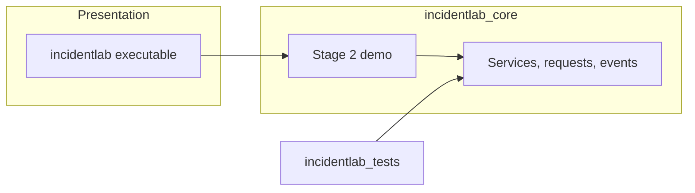

# IncidentLab

IncidentLab is a distributed systems failure simulator for learning how a small microservice architecture behaves when calls time out, retries stack up, and circuit breakers open.

The whole system runs in one process. Services are models. Nothing is deployed, and nothing listens on a network.

**Stage 3 of 10 is implemented.** The program prints the Stage 1 banner, then runs a discrete-event simulation of one trace. Failure injection, retries, queues, and the window are not in the build yet.

## Implemented features

- C++17 CMake build with a core library, a console executable, and a CTest target
- Debug and Release configurations, without assuming a particular compiler
- One version number, owned by the build and reported at startup
- Domain model: `Request`, `Service`, `OrderService`, `PaymentService`, `InventoryService`, `ServiceResult`, `Event`, `EventHistory`
- A fixed Stage 2 script, `run_stage2_demo()`, kept for the original domain tests
- A discrete-event engine: `SimulationClock`, `EventScheduler`, `SimulationEngine`
- A Stage 3 console demonstration: three requests at 10 ms, 30 ms, and 50 ms
- Automated tests for the domain model and the simulation

## Planned features

These are not in the build yet.

- A simulated API gateway, event queue, and databases
- Failure injection
- Retries, circuit breakers, and a dead-letter queue
- Health and metrics
- Side-by-side comparison of resilience strategies
- An interactive architecture view (raylib)
- GoogleTest and a GitHub Actions workflow

## Technology stack

| Now | Later, in the named stage |
| --- | --- |
| C++17, CMake, CTest, the C++ standard library | GoogleTest (Stage 9, only if it can be vendored without a download) |
| Git | raylib (Stage 7) |
|  | GitHub Actions (Stage 9) |

The tests are an executable in `tests/`. CMake does not download GoogleTest. The simulation must keep working without the window.

## Discrete-event simulation

A discrete-event simulation does not step through every millisecond. It keeps a list of future requests and jumps the clock to the time of the next one. Nothing waits. `sleep()` is not used, because virtual time and wall-clock time are different things. A request scheduled 50 ms later runs on the next loop iteration.

`SimulationClock` stores that virtual time in milliseconds. It starts at 0. `advance_to` moves it forward. A smaller value throws `std::invalid_argument`.

`EventScheduler` stores requests that have not run yet. `std::priority_queue` returns the earliest time first. When two requests share a time, the one scheduled first runs first. Scheduling and removal are O(log N). Looking up a service by name in `std::unordered_map` is O(1) on average. Running N queued requests is O(N log N).

`SimulationEngine` owns the clock, the scheduler, and one `EventHistory`. `register_service` keeps a non-owning pointer, so the service object must outlive the engine. A request is routed by `target_service`. The call goes through `Service::handle`, so the engine does not switch on the concrete class. An unknown name becomes `ServiceStatus::Rejected` and a `RequestRejected` event. The simulation continues.

`ScheduledEvent` means "run this request later." `Event` means "this already happened." They are different types. Virtual time is stored beside the history, in `SimulationReport::event_times`, at the same index as `history.events()`. The history itself is unchanged from Stage 2.

`run_next(n)` executes at most n queued requests and leaves the rest, the clock, and the history in place. `run_next(0)` does nothing. `run()` finishes whatever is still queued.

The console calls `run_stage3_demo()`. That function schedules Inventory at 50 ms, Order at 10 ms, and Payment at 30 ms, then asks the engine to run. The printed order is 10, then 30, then 50. `run_stage2_demo()` is still in the library for the original tests. The console no longer calls it.

## Domain model

A `Request` is one call. It carries `request_id`, `trace_id`, `source_service`, `target_service`, and `operation`. Construction throws `std::invalid_argument` when the request id, trace id, target service, or operation is empty. The source service may be empty.

`request_id` names that single call. `trace_id` names the workflow the call belongs to. In the demonstration, `REQ-001`, `REQ-002`, and `REQ-003` all use `TRACE-001`. Filtering the history by `TRACE-001` returns every event from the workflow. Filtering by `REQ-002` returns only that call's events.

`Service` is an abstract base with `name()` and `handle()`. The three concrete services inherit from it:

| Service | Operation | Success text |
| --- | --- | --- |
| `OrderService` | `CreateOrder` | `Order created successfully` |
| `PaymentService` | `ProcessPayment` | `Payment processed successfully` |
| `InventoryService` | `ReserveInventory` | `Inventory reserved successfully` |

Any other operation returns `ServiceStatus::Rejected`. That is a normal result, not an exception.

`Event` records one fact about a request: an id, the request id, the trace id, the service name, a type (`RequestReceived`, `RequestCompleted`, or `RequestRejected`), and a message. `EventHistory` stores events in insertion order and can filter them. The demonstration is a fixed script in `run_stage2_demo()`. It is not the scheduler. Stage 3 replaces that script.

Details and the class diagram are in [docs/architecture.md](docs/architecture.md).

## Architecture

Presentation depends on the core library. The library does not know how it is displayed.



## Requirements

- CMake 3.20 or newer
- A C++17 compiler: Visual Studio (MSVC), GCC, or Clang
- Git

CMake finds the compiler on your `PATH`. The project does not pin one.

If Windows reports that no compiler was found:

1. Install [Visual Studio Build Tools](https://visualstudio.microsoft.com/visual-cpp-build-tools/) and select the **Desktop development with C++** workload. That workload includes MSVC and CMake.
2. Or install [CMake](https://cmake.org/download/) yourself and use an existing GCC or Clang (for example the LLVM installer, or MinGW from MSYS2).

In VS Code, the CMake Tools extension can configure the presets in `CMakePresets.json`.

## Build

Run these commands from the repository root.

### Debug and Release with presets

Single-config generators (Ninja, Makefiles, MinGW) use the preset's build type. Multi-config generators (Visual Studio) use the preset's configuration.

```bash
cmake --preset debug
cmake --build --preset debug

cmake --preset release
cmake --build --preset release
```

### Without presets

Single-config generator:

```bash
cmake -S . -B build/debug -DCMAKE_BUILD_TYPE=Debug
cmake --build build/debug

cmake -S . -B build/release -DCMAKE_BUILD_TYPE=Release
cmake --build build/release
```

Visual Studio on Windows (one build tree, two configurations):

```bat
cmake -S . -B build
cmake --build build --config Debug
cmake --build build --config Release
```

To choose a compiler explicitly:

```bash
cmake -S . -B build/debug -DCMAKE_BUILD_TYPE=Debug -DCMAKE_CXX_COMPILER=clang++
```

In-source builds (`cmake .` in the repository root) are rejected. Always pass a separate build directory with `-B`.

## Test

The domain tests are registered with CTest. From the repository root, after a build:

```bash
ctest --test-dir build/debug --output-on-failure
ctest --test-dir build/release --output-on-failure
```

Visual Studio multi-config:

```bat
ctest --test-dir build -C Debug --output-on-failure
ctest --test-dir build -C Release --output-on-failure
```

`incidentlab_domain` is one CTest test. It runs every case in `tests/domain_tests.cpp` and `tests/simulation_tests.cpp`. A failing case prints `FAILED` and the test process exits with status 1.

## Run

Single-config preset (Ninja, Makefiles, or MinGW):

```bash
./build/debug/incidentlab
```

On Windows that file is `build\debug\incidentlab.exe`.

Visual Studio is multi-config, so the configuration name is an extra directory:

- preset build: `build\debug\Debug\incidentlab.exe`
- `cmake -S . -B build` then `--config Debug`: `build\Debug\incidentlab.exe`

Expected output:

```text
INCIDENTLAB
Distributed Systems Failure Simulator
Version 0.1.0

Status: Application initialized successfully.

========== STAGE 3 SIMULATION ==========

Simulation started.
Virtual time: 0 ms

[10 ms] REQ-001 -> OrderService
Operation: CreateOrder
Status: SUCCESS

[30 ms] REQ-002 -> PaymentService
Operation: ProcessPayment
Status: SUCCESS

[50 ms] REQ-003 -> InventoryService
Operation: ReserveInventory
Status: SUCCESS

========== SIMULATION REPORT ==========

Trace: TRACE-001

Processed Requests: 3
Successful Requests: 3
Rejected Requests: 0
Pending Requests: 0

Total Events: 6
Final Virtual Time: 50 ms

Simulation completed successfully.
```

The process exits with status 0. If the report cannot be written, it prints an error to standard error and exits with status 1.

## Project layout

```text
.
├── CMakeLists.txt
├── CMakePresets.json
├── include/incidentlab/     # public headers of the core library
│   └── simulation/          # clock, scheduler, engine, report
├── src/
│   ├── main.cpp             # banner and report formatting
│   ├── simulation/
│   └── *.cpp                # library implementation
├── tests/
│   ├── test_harness.hpp
│   ├── domain_tests.cpp
│   └── simulation_tests.cpp
├── docs/architecture.md
└── README.md
```

`assets/` and `.github/workflows/` are added in the stages that need them.

## Development roadmap

| Stage | Focus | Status |
| --- | --- | --- |
| 1 | Architecture and project setup | Implemented |
| 2 | Service and event models | Implemented |
| 3 | Simulation engine | Implemented |
| 4 | Failure injection | Planned |
| 5 | Resilience patterns | Planned |
| 6 | Metrics and observability | Planned |
| 7 | Interactive visualization | Planned |
| 8 | Scenario comparison | Planned |
| 9 | Extended testing and CI | Planned |
| 10 | Documentation and portfolio release | Planned |

Stage 4, when approved, adds failure injection. The engine can record a rejected result without a change to `Service::handle`.

## License

A license will be chosen in Stage 10, when the project is prepared for public release. Until then, all rights are reserved.
