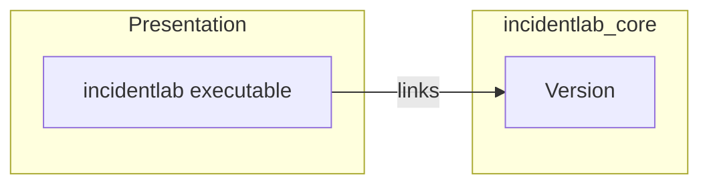

# IncidentLab

IncidentLab is a distributed systems failure simulator for learning how a small microservice architecture behaves when calls time out, retries stack up, and circuit breakers open.

The whole system runs in one process. Services, queues, and databases are models. Nothing is deployed, and nothing listens on a network.

**Stage 1 of 10 is implemented.** The project configures, builds, and prints a startup banner. No simulation behavior exists yet.

## Implemented features

- C++17 CMake build with a core library and a console executable
- Debug and Release configurations, without assuming a particular compiler
- One version number, owned by the build and reported at startup
- Architecture boundaries that later stages can extend (see [docs/architecture.md](docs/architecture.md))

## Planned features

These are not in the build yet.

- A simulated API gateway, order service, payment service, inventory service, event queue, and databases
- Request generation and visible service-to-service calls
- Failure injection
- Retries and circuit breakers
- Queue processing and a dead-letter queue
- Health and metrics
- Side-by-side comparison of resilience strategies
- An interactive architecture view (raylib)
- GoogleTest and a GitHub Actions workflow

## Technology stack

| Now | Later, in the named stage |
| --- | --- |
| C++17, CMake, the C++ standard library | GoogleTest (Stage 9) |
| Git | raylib (Stage 7) |
|  | GitHub Actions (Stage 9) |

No other dependencies are planned. The simulation must keep working without the window.

## Architecture

Presentation depends on the core library. The library does not know how it is displayed.



Today the library only reports its version. From Stage 2 onward the domain model and the simulation engine live in that same library. The window, when it arrives, will be a separate target that links the library and draws what the engine already computed.

The dependency rule, the stage-by-stage map, and the reason there is no class hierarchy yet are written up in [docs/architecture.md](docs/architecture.md).

## Requirements

- CMake 3.20 or newer
- A C++17 compiler: Visual Studio (MSVC), GCC, or Clang
- Git

CMake finds the compiler on your `PATH`. The project does not pin one.

If Windows reports that no compiler was found:

1. Install [Visual Studio Build Tools](https://visualstudio.microsoft.com/visual-cpp-build-tools/) and select the **Desktop development with C++** workload. That workload includes MSVC and CMake.
2. Or install [CMake](https://cmake.org/download/) yourself and use an existing GCC or Clang (for example the LLVM installer, or MinGW from MSYS2).

In VS Code, the CMake Tools extension can configure the presets in `CMakePresets.json`.

## Build

Run these commands from the repository root.

### Debug and Release with presets

Single-config generators (Ninja, Makefiles, MinGW) use the preset's build type. Multi-config generators (Visual Studio) use the preset's configuration.

```bash
cmake --preset debug
cmake --build --preset debug

cmake --preset release
cmake --build --preset release
```

### Without presets

Single-config generator:

```bash
cmake -S . -B build/debug -DCMAKE_BUILD_TYPE=Debug
cmake --build build/debug

cmake -S . -B build/release -DCMAKE_BUILD_TYPE=Release
cmake --build build/release
```

Visual Studio on Windows (one build tree, two configurations):

```bat
cmake -S . -B build
cmake --build build --config Debug
cmake --build build --config Release
```

To choose a compiler explicitly:

```bash
cmake -S . -B build/debug -DCMAKE_BUILD_TYPE=Debug -DCMAKE_CXX_COMPILER=clang++
```

In-source builds (`cmake .` in the repository root) are rejected. Always pass a separate build directory with `-B`.

## Run

Single-config preset (Ninja, Makefiles, or MinGW):

```bash
./build/debug/incidentlab
```

On Windows that file is `build\debug\incidentlab.exe`.

Visual Studio is multi-config, so the configuration name is an extra directory:

- preset build: `build\debug\Debug\incidentlab.exe`
- `cmake -S . -B build` then `--config Debug`: `build\Debug\incidentlab.exe`

Expected output:

```text
INCIDENTLAB
Distributed Systems Failure Simulator
Version 0.1.0

Status: Application initialized successfully.
```

The process exits with status 0. If the banner cannot be written, it prints an error to standard error and exits with status 1.

## Project layout

```text
.
├── CMakeLists.txt          # library target + executable target
├── CMakePresets.json       # debug and release presets
├── include/incidentlab/    # public headers of the core library
│   └── version.hpp
├── src/
│   ├── main.cpp            # console presentation
│   └── version.cpp         # library implementation
├── docs/architecture.md
└── README.md
```

`tests/`, `assets/`, and `.github/workflows/` are added in the stages that need them.

## Development roadmap

| Stage | Focus | Status |
| --- | --- | --- |
| 1 | Architecture and project setup | Implemented |
| 2 | Service and event models | Planned |
| 3 | Simulation engine | Planned |
| 4 | Failure injection | Planned |
| 5 | Resilience patterns | Planned |
| 6 | Metrics and observability | Planned |
| 7 | Interactive visualization | Planned |
| 8 | Scenario comparison | Planned |
| 9 | Automated testing and CI | Planned |
| 10 | Documentation and portfolio release | Planned |

Stage 2 starts only after Stage 1 is reviewed: domain types for services, requests, and events, still with no failure injection and no window.

## License

A license will be chosen in Stage 10, when the project is prepared for public release. Until then, all rights are reserved.
