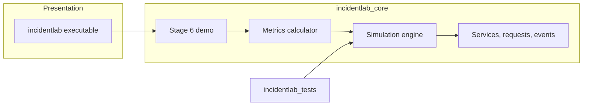

# IncidentLab

IncidentLab is a distributed systems failure simulator for learning how a small microservice architecture behaves when calls time out, retries stack up, and circuit breakers open.

The whole system runs in one process. Services are models. Nothing is deployed, and nothing listens on a network.

**Stage 6 of 10 is implemented.** The program prints the Stage 1 banner, then a metrics report calculated from one simulation. The window is not in the build yet.

## Implemented features

- C++17 CMake build with a core library, a console executable, and a CTest target
- Debug and Release configurations, without assuming a particular compiler
- One version number, owned by the build and reported at startup
- Domain model: `Request`, `Service`, `OrderService`, `PaymentService`, `InventoryService`, `ServiceResult`, `Event`, `EventHistory`
- A fixed Stage 2 script, `run_stage2_demo()`, kept for the original domain tests
- A discrete-event engine: `SimulationClock`, `EventScheduler`, `SimulationEngine`
- A Stage 3 demonstration, `run_stage3_demo()`, kept for the original simulation tests
- Deterministic failure injection: service failure, slow response, timeout, and dropped request
- A Stage 4 demonstration, `run_stage4_demo()`, kept for the failure-injection tests
- Retry with virtual-time backoff, a per-service circuit breaker, and an in-memory dead-letter queue
- A Stage 5 console demonstration of those three patterns, kept in the library
- Metrics calculated from the simulation report: rates, latency, throughput, retries, circuit breakers, and the dead-letter queue
- An incident timeline built from the event history
- A Stage 6 console demonstration
- Automated tests for the domain model, the simulation, failure injection, resilience, and observability

## Planned features

These are not in the build yet.

- A simulated API gateway, event queue, and databases
- Side-by-side comparison of resilience strategies
- An interactive architecture view (raylib)
- GoogleTest and a GitHub Actions workflow

## Technology stack

| Now | Later, in the named stage |
| --- | --- |
| C++17, CMake, CTest, the C++ standard library | GoogleTest (Stage 9, only if it can be vendored without a download) |
| Git | raylib (Stage 7) |
|  | GitHub Actions (Stage 9) |

The tests are an executable in `tests/`. CMake does not download GoogleTest. The simulation must keep working without the window.

## Discrete-event simulation

A discrete-event simulation does not step through every millisecond. It keeps a list of future requests and jumps the clock to the time of the next one. Nothing waits. `sleep()` is not used, because virtual time and wall-clock time are different things. A request scheduled 50 ms later runs on the next loop iteration.

`SimulationClock` stores that virtual time in milliseconds. It starts at 0. `advance_to` moves it forward. A smaller value throws `std::invalid_argument`.

`EventScheduler` stores requests that have not run yet. `std::priority_queue` returns the earliest time first. When two requests share a time, the one scheduled first runs first. Scheduling and removal are O(log N). Looking up a service by name in `std::unordered_map` is O(1) on average. Running N queued requests is O(N log N).

`SimulationEngine` owns the clock, the scheduler, and one `EventHistory`. `register_service` keeps a non-owning pointer, so the service object must outlive the engine. A request is routed by `target_service`. The call goes through `Service::handle`, so the engine does not switch on the concrete class. An unknown name becomes `ServiceStatus::Rejected` and a `RequestRejected` event. The simulation continues.

`ScheduledEvent` means "run this request later." `Event` means "this already happened." They are different types. Virtual time is stored beside the history, in `SimulationReport::event_times`, at the same index as `history.events()`. The history itself is unchanged from Stage 2.

`run_next(n)` finishes at most n requests. `run_next(0)` does nothing. `run()` drains every queued start and finish. If a service throws, that start stays queued, nothing new is recorded for it, and the exception is not swallowed. A simulated failure is a normal outcome. It does not throw. `run_next` does not step one scheduler action. Stage 7 may need that kind of step to draw the timeline.

With no failure configuration, a request is received and completed at its scheduled time. A slow response, a delayed failure, or a timeout leaves a finish action on the same queue, so other requests can run before that outcome. The clock never moves backward. Virtual delays do not sleep.

`configure_failure("PaymentService", FailureConfig{FailureType::Timeout, 200, 100, 1})` times out every Payment request. The request starts at its scheduled time and times out 100 ms later, not 200 ms later. `every_nth_request` of 3 fails the 3rd, 6th, and so on. Each service has its own counter. Setting the policy again resets that counter. `FailureType::None` removes it.

The console calls `run_stage6_demo()`. `run_stage5_demo()`, `run_stage4_demo()`, `run_stage3_demo()`, and `run_stage2_demo()` remain in the library.

## Resilience

Retry, the circuit breaker, and the dead-letter queue are optional. A service with none of them still behaves as it did in Stage 4.

`configure_retry("PaymentService", RetryConfig{3, 100, 2.0})` allows three attempts. The first retry waits 100 ms of virtual time. The next waits 200 ms. There is no jitter and no `sleep()`. `Failed`, `TimedOut`, and `Dropped` are retried. `Rejected` is not. An unexpected C++ exception is not turned into a retry.

`configure_circuit_breaker("PaymentService", CircuitBreakerConfig{3, 500})` opens the circuit after three consecutive failures. While it is open, new attempts are blocked and do not call `handle()`. After 500 ms, one half-open probe is allowed. A successful probe closes the circuit. A failed probe opens it again. A request that was already running when the circuit opened is allowed to finish, and that late outcome does not change the breaker.

The dead-letter queue stores a logical request when its failure is final and that service has a retry policy or a circuit breaker. Successful and rejected requests are not stored. The queue is not replayed and is not written to disk.

A logical request has one final result. Retries are extra attempts, not extra logical requests. `processed_requests` counts final outcomes. `total_attempts` counts starts that were allowed to reach the service.

## Metrics

`MetricsCalculator::calculate` reads a `SimulationReport` and returns an `ObservabilityReport`. It does not change the report, the engine, or the history. The console only formats that snapshot.

Rates use completed logical requests. A request that fails and then succeeds is one success. Pending and in-progress requests are not completed. `Rejected`, `Failed`, `TimedOut`, `Dropped`, and `CircuitRejected` stay separate, and every one of them counts as unsuccessful. With no completed requests, both rates are 0%. That is an empty sample, not a measured success rate.

Logical latency is the final completion time minus the original start time. It includes slow responses, timeout waits, and retry backoff. It does not include time before the first start. Percentiles use nearest-rank: `rank = ceil(percentile × count)`, then the value at `rank - 1` in the sorted sample. The implementation uses the integer form of 50/100, 95/100, and 99/100. An empty sample reports 0 ms for every latency field.

Throughput is completed requests per virtual second. The window starts at the earliest original start and ends at the latest completion, using completed requests only. One virtual second is 1000 ms. If nothing completed, or every completion shares that start time, throughput is unavailable rather than infinite.

A request requires a retry when the history contains `RetryScheduled` for its id. Recovered means that request's final status is success. Exhausted means the failure used the last attempt allowed by its retry policy. A dead-letter entry is not assumed to be exhausted: a circuit block is dead-lettered without being an exhausted retry.

Circuit openings count `CircuitOpened` events, not later blocked requests. The final state comes from the breaker snapshot on the report. The timeline copies history order, including equal timestamps, and can be filtered by service, request id, or trace id.

## Domain model

A `Request` is one call. It carries `request_id`, `trace_id`, `source_service`, `target_service`, and `operation`. Construction throws `std::invalid_argument` when the request id, trace id, target service, or operation is empty. The source service may be empty.

`request_id` names that single call. `trace_id` names the workflow the call belongs to. In the demonstration, `REQ-001`, `REQ-002`, and `REQ-003` all use `TRACE-001`. Filtering the history by `TRACE-001` returns every event from the workflow. Filtering by `REQ-002` returns only that call's events.

`Service` is an abstract base with `name()` and `handle()`. The three concrete services inherit from it:

| Service | Operation | Success text |
| --- | --- | --- |
| `OrderService` | `CreateOrder` | `Order created successfully` |
| `PaymentService` | `ProcessPayment` | `Payment processed successfully` |
| `InventoryService` | `ReserveInventory` | `Inventory reserved successfully` |

Any other operation returns `ServiceStatus::Rejected`. That is a normal result, not an exception.

`Event` records one fact about a request: an id, the request id, the trace id, the service name, a type, and a message. The types include `RequestReceived`, `RequestCompleted`, `RequestRejected`, `RequestFailed`, `RequestTimedOut`, `RequestDropped`, plus retry, circuit, and dead-letter events when those features are used. `EventHistory` stores events in insertion order and can filter them. The demonstration is a fixed script in `run_stage2_demo()`. It is not the scheduler. Stage 3 replaces that script.

Details and the class diagram are in [docs/architecture.md](docs/architecture.md).

## Architecture

Presentation depends on the core library. The library does not know how it is displayed.



## Requirements

- CMake 3.20 or newer
- A C++17 compiler: Visual Studio (MSVC), GCC, or Clang
- Git

CMake finds the compiler on your `PATH`. The project does not pin one.

If Windows reports that no compiler was found:

1. Install [Visual Studio Build Tools](https://visualstudio.microsoft.com/visual-cpp-build-tools/) and select the **Desktop development with C++** workload. That workload includes MSVC and CMake.
2. Or install [CMake](https://cmake.org/download/) yourself and use an existing GCC or Clang (for example the LLVM installer, or MinGW from MSYS2).

In VS Code, the CMake Tools extension can configure the presets in `CMakePresets.json`.

## Build

Run these commands from the repository root.

### Debug and Release with presets

Single-config generators (Ninja, Makefiles, MinGW) use the preset's build type. Multi-config generators (Visual Studio) use the preset's configuration.

```bash
cmake --preset debug
cmake --build --preset debug

cmake --preset release
cmake --build --preset release
```

### Without presets

Single-config generator:

```bash
cmake -S . -B build/debug -DCMAKE_BUILD_TYPE=Debug
cmake --build build/debug

cmake -S . -B build/release -DCMAKE_BUILD_TYPE=Release
cmake --build build/release
```

Visual Studio on Windows (one build tree, two configurations):

```bat
cmake -S . -B build
cmake --build build --config Debug
cmake --build build --config Release
```

To choose a compiler explicitly:

```bash
cmake -S . -B build/debug -DCMAKE_BUILD_TYPE=Debug -DCMAKE_CXX_COMPILER=clang++
```

In-source builds (`cmake .` in the repository root) are rejected. Always pass a separate build directory with `-B`.

## Test

The domain tests are registered with CTest. From the repository root, after a build:

```bash
ctest --test-dir build/debug --output-on-failure
ctest --test-dir build/release --output-on-failure
```

Visual Studio multi-config:

```bat
ctest --test-dir build -C Debug --output-on-failure
ctest --test-dir build -C Release --output-on-failure
```

`incidentlab_domain` is one CTest test. It runs every case in `tests/domain_tests.cpp`, `tests/simulation_tests.cpp`, `tests/failure_tests.cpp`, `tests/resilience_tests.cpp`, and `tests/observability_tests.cpp`. A failing case prints `FAILED` and the test process exits with status 1.

## Run

Single-config preset (Ninja, Makefiles, or MinGW):

```bash
./build/debug/incidentlab
```

On Windows that file is `build\debug\incidentlab.exe`.

Visual Studio is multi-config, so the configuration name is an extra directory:

- preset build: `build\debug\Debug\incidentlab.exe`
- `cmake -S . -B build` then `--config Debug`: `build\Debug\incidentlab.exe`

Expected output starts like this. The executable also prints every service, every dead-letter row, and the full timeline.

```text
INCIDENTLAB
Distributed Systems Failure Simulator
Version 0.1.0

Status: Application initialized successfully.

========== STAGE 6 METRICS & OBSERVABILITY ==========

GLOBAL METRICS

Completed Requests: 8
Successful Requests: 4
Failed Requests: 3
Circuit Rejections: 1

Success Rate: 50.00%
Failure Rate: 50.00%

Total Attempts: 9
Retry Attempts: 2
Recovered After Retry: 1
Exhausted Retries: 1

Average Latency: 25.00 ms
P50 Latency: 0.00 ms
P95 Latency: 100.00 ms
P99 Latency: 100.00 ms

Observation Window: 0 ms to 1000 ms
Throughput: 8.00 requests/second

INCIDENT TIMELINE

[0 ms] OrderService | REQ-O1 | TRACE-STAGE6 | RequestReceived
[10 ms] PaymentService | REQ-P1 | TRACE-STAGE6 | RequestFailed
[40 ms] InventoryService | REQ-I1 | TRACE-STAGE6 | RetryScheduled
[140 ms] InventoryService | REQ-I1 | TRACE-STAGE6 | RequestCompleted
[300 ms] InventoryService | REQ-I2 | TRACE-STAGE6 | DeadLettered
[1000 ms] PaymentService | REQ-P4 | TRACE-STAGE6 | CircuitHalfOpened
[1000 ms] PaymentService | REQ-P4 | TRACE-STAGE6 | CircuitClosed

========== END OF REPORT ==========
```

Those values come from the engine. They are not printed from a fixed table. The process exits with status 0. If the report cannot be written, it prints an error to standard error and exits with status 1.

## Project layout

```text
.
├── CMakeLists.txt
├── CMakePresets.json
├── include/incidentlab/     # public headers of the core library
│   ├── simulation/          # clock, scheduler, engine, report
│   └── observability/       # metrics and the Stage 6 demo
├── src/
│   ├── main.cpp             # banner and report formatting
│   ├── simulation/
│   ├── observability/
│   └── *.cpp                # library implementation
├── tests/
│   ├── test_harness.hpp
│   ├── domain_tests.cpp
│   ├── simulation_tests.cpp
│   ├── failure_tests.cpp
│   ├── resilience_tests.cpp
│   └── observability_tests.cpp
├── docs/architecture.md
└── README.md
```

`assets/` and `.github/workflows/` are added in the stages that need them.

## Development roadmap

| Stage | Focus | Status |
| --- | --- | --- |
| 1 | Architecture and project setup | Complete |
| 2 | Service and event models | Complete |
| 3 | Simulation engine | Complete |
| 4 | Failure injection | Complete |
| 5 | Resilience patterns | Complete |
| 6 | Metrics and observability | Implemented |
| 7 | Interactive visualization | Planned |
| 8 | Scenario comparison | Planned |
| 9 | Extended testing and CI | Planned |
| 10 | Documentation and portfolio release | Planned |

Stage 7, when approved, draws the simulation. Retries do not jitter, percentiles are nearest-rank, and the dead-letter queue is not replayed.

## License

A license will be chosen in Stage 10, when the project is prepared for public release. Until then, all rights are reserved.
