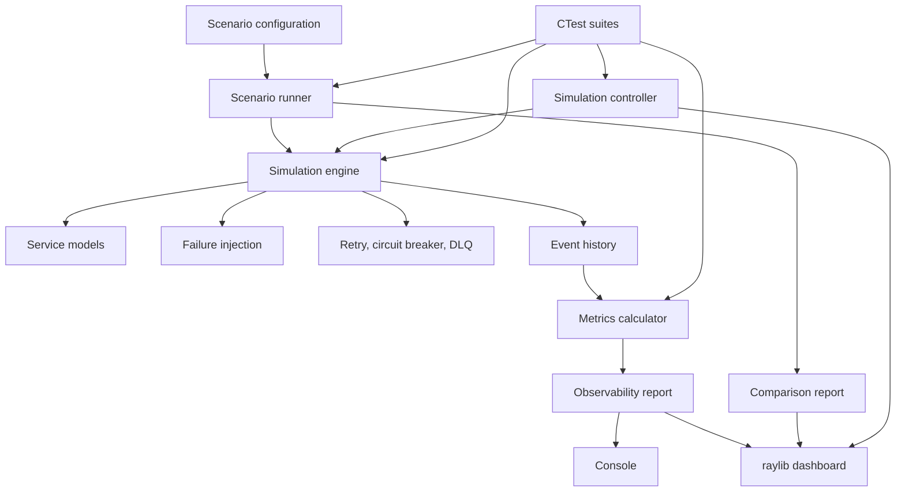

# Architecture

IncidentLab simulates service calls inside one process. Virtual time replaces the system clock. Nothing listens on a network.

The core library does not include raylib, and the default CMake presets do not build the window. Stages 1 through 7 are in the library. Stage 8 comparison and Stage 9 tests are implemented. The 1.0.0 notes are a release candidate. The compiled version string is still 0.1.0.

## Layers



| Layer | Types | Responsibility |
| --- | --- | --- |
| Domain | `Request`, `Service`, `OrderService`, `PaymentService`, `InventoryService`, `Event`, `EventHistory` | What a call and a recorded fact are |
| Simulation | `SimulationClock`, `EventScheduler`, `SimulationEngine` | Virtual time and deterministic execution |
| Failure injection | `FailureConfig` | One policy per service name |
| Resilience | `RetryConfig`, `CircuitBreaker`, `DeadLetterQueue` | Optional recovery and isolation |
| Observability | `MetricsCalculator`, `ObservabilityReport` | Rates, latency, throughput, timeline |
| Visualization | `SimulationController`, `VisualizationSnapshot` | Playback of one fixed scenario |
| Presentation | `incidentlab`, `incidentlab_gui` | Text report or raylib drawing |
| Comparison | `ScenarioRunner`, `ComparisonReport` | Four strategies, one workload |
| Tests and CI | `incidentlab_tests`, `.github/workflows/ci.yml` | Headless checks |

Presentation depends on the core. The core depends only on the C++ standard library. Tests depend on the core. The GUI is a separate executable.

## Domain

`Service` is an abstract base with `name()` and `handle(const Request&)`. `OrderService`, `PaymentService`, and `InventoryService` are `final` subclasses. The engine calls `handle` through a `Service&` and does not switch on the concrete class. An unsupported operation returns `ServiceStatus::Rejected`.

`Request` construction rejects an empty request id, trace id, target service, or operation. `Event` is a recorded fact. Virtual time is not stored on `Event`. The engine keeps a parallel timestamp vector so the Stage 2 event type stays stable.

## Simulation

`SimulationClock` starts at 0. `advance_to` moves forward or stays at the same timestamp. A smaller value throws `std::invalid_argument`. There is no reset method. A new clock starts at 0 and does not change another clock.

`EventScheduler` orders work by virtual time, then by insertion sequence. Scheduling in the past throws. `pop_next` on an empty scheduler returns `std::nullopt`. `discard_next` on an empty scheduler does nothing.

`SimulationEngine::schedule_request` queues work. It does not call the service. `run_next(n)` finishes at most n logical requests. `run()` drains the queue. `step_once()` runs one scheduler action and is what the window's Step control uses. If `handle` throws, the start stays queued and the breaker is unchanged. Simulated failures are normal outcomes. They do not throw.

`register_service` stores a non-owning pointer. The service object must outlive every use of the engine. Scenario and controller sessions declare the services before the engine so destruction destroys the engine first.

## Failure injection

`configure_failure` replaces the policy for one service and resets that service's counter. Policies do not stack. `FailureType::None` removes the policy.

| Type | Behavior |
| --- | --- |
| `ServiceFailure` | Terminal `Failed` at the start time. `handle` is not called. |
| `SlowResponse` | `handle` runs. Completion is `delay_ms` later. The delay is virtual. |
| `Timeout` | Deadline is `timeout_ms`, which must be shorter than `delay_ms`. The outcome is `TimedOut`. |
| `DroppedRequest` | One `RequestDropped` event at the start time. There is no completion event. |

`every_nth_request` selects which deliveries use the policy. A value of 1 applies it to every delivery, including retries. Each service has its own counter.

## Resilience

Retry, the circuit breaker, and the dead-letter queue are optional.

`RetryConfig{max_attempts, initial_delay_ms, multiplier}` counts the first try inside `max_attempts`. `Failed`, `TimedOut`, and `Dropped` can be retried. `Rejected` is not. An unexpected C++ exception is not retried. The first retry waits `initial_delay_ms`. The next wait is multiplied. There is no jitter and no `sleep`. If the failure opens the circuit, the engine does not schedule the retry.

The breaker starts closed. Consecutive failures are counted when an attempt finishes. While the circuit is open, a new attempt is `CircuitRejected` and does not call `handle`. When `now >= opened_at + reset_timeout_ms`, one half-open probe is allowed. A successful probe closes the circuit. A failed probe opens it again. A request that started while the circuit was closed, and finishes after it has opened, does not change the breaker. Breakers on different services are independent. Reconfiguring a breaker resets it to closed.

A terminal failure is dead-lettered only when that service has a retry policy with at least two attempts, or a circuit breaker. Successful and rejected requests are not stored. The queue is in memory, keeps insertion order, rejects a duplicate request id, and is not replayed. Two engines do not share a queue.

## Observability

`MetricsCalculator::calculate` reads a `SimulationReport` and returns an owned `ObservabilityReport`. It does not run the simulation and does not modify the report. The snapshot remains valid after the engine is destroyed.

Each logical request is counted once. Pending and in-progress requests are excluded. The terminal statuses are mutually exclusive:

```text
completed = successful + rejected + failed + timed out + dropped + circuit rejected
```

`successful + failed + circuit rejected` is not the definition of completed. The success rate is `successful / completed`. The failure rate is `(completed - successful) / completed`, so it includes rejected, failed, timed out, dropped, and circuit-rejected requests. When `completed` is 0, both rates are 0.

Latency uses the original start and the terminal completion, so retry backoff is included. Percentiles use nearest-rank: `rank = ceil(percentile * count)`. An empty sample stores zeros. Those zeros are not an observed latency.

Throughput is `completed * 1000 / (latest completion - earliest original start)` and is expressed as requests per second. It is absent when nothing completed or the window duration is zero. It is never NaN.

`retry_attempts` counts `RetryScheduled` events. `total_attempts` counts starts that reached a service. A circuit block is not an attempt and is not an exhausted retry. Exhausted retries are terminal failures that used the last allowed attempt.

## Visualization

`SimulationController` owns one session and a copied `VisualizationSnapshot`. Start, pause, resume, step, reset, and playback speed change when the engine may run. They do not invent outcomes. Speed changes how much frame time must accumulate before the next step. The intervals are 1 s, 0.5 s, 0.25 s, and 0.125 s. Pause does not advance virtual time.

The built-in visualization scenario is separate from the Stage 6 console scenario and from the Stage 8 comparison. It uses trace `TRACE-VIZ`, a timeout on every second Order delivery, a payment circuit breaker, and inventory retry. Clicking a service node stores a name, not a pointer. A missing metric is shown as unavailable rather than as zero success.

`incidentlab_gui` links the core and raylib. It loads DejaVu Sans from the directory beside the executable, then from `INCIDENTLAB_FONT_DIR`, then from common system paths. The default raylib bitmap is the fallback. Switching between Live Simulation and Scenario Comparison does not reset the live controller.

## Scenario comparison

`comparison_workload()` is the only request list. `comparison_faults()` maps each request id to the status of attempt 1 and, when present, later attempts. `ScenarioRunner::run` builds a new session, applies the same slow-response delay of 20 ms, enables retry or a breaker only when that scenario asks for it, runs the engine, and calls `MetricsCalculator`.

The four ids are `baseline`, `retry`, `circuit`, and `full`. Reversing the order does not change a scenario's metrics. `ComparisonView` caches the report. Selection does not run the engine. `rerun()` is the refresh.

Success-rate deltas are percentage points: `value - baseline`. The relative percent is `(value - baseline) / baseline * 100` and is unavailable when the baseline value is 0. Missing throughput stays non-comparable.

On the locked workload the results are:

| Metric | Baseline | Retry Only | Circuit Breaker | Full Resilience |
| --- | ---: | ---: | ---: | ---: |
| Completed | 10 | 10 | 10 | 10 |
| Successful | 4 | 7 | 3 | 4 |
| Success rate | 40% | 70% | 30% | 40% |
| Average latency | 20 ms | 92 ms | 18 ms | 50 ms |
| Attempts | 10 | 16 | 9 | 10 |
| Retry attempts | 0 | 6 | 0 | 3 |
| Circuit openings | 0 | 0 | 2 | 2 |
| Circuit rejected | 0 | 0 | 1 | 3 |
| DLQ entries | 0 | 3 | 7 | 6 |

Full Resilience does not have the highest success rate on this workload. The breaker opens before some retries finish.

## Testing and CI

`incidentlab_tests` registers every case in one process. CTest starts that executable once per source suite: domain, simulation, failure, resilience, observability, visualization, scenario, and quality. No suite opens a window or waits for virtual time.

Sanitizer and coverage flags are public compile and link options of `incidentlab_core`, off by default, and mutually exclusive. The workflow in `.github/workflows/ci.yml` uses `contents: read`, Ubuntu 24.04, and no secrets. GCC covers Debug, Release, sanitizers, and coverage. Clang covers an extra Debug job.

The workflow on commit `36ae182` succeeded for all five jobs. Coverage regenerated during this release check was 84.3% of lines (1472/1747) and 91.8% of functions (167/182) in the core. GUI sources are outside that scope.
