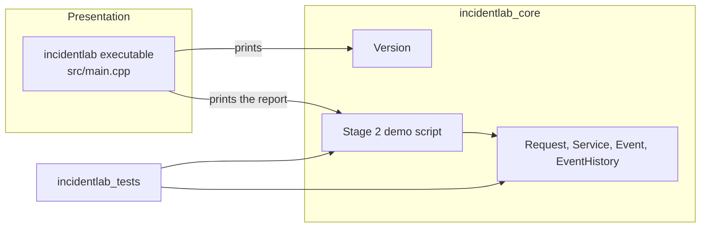
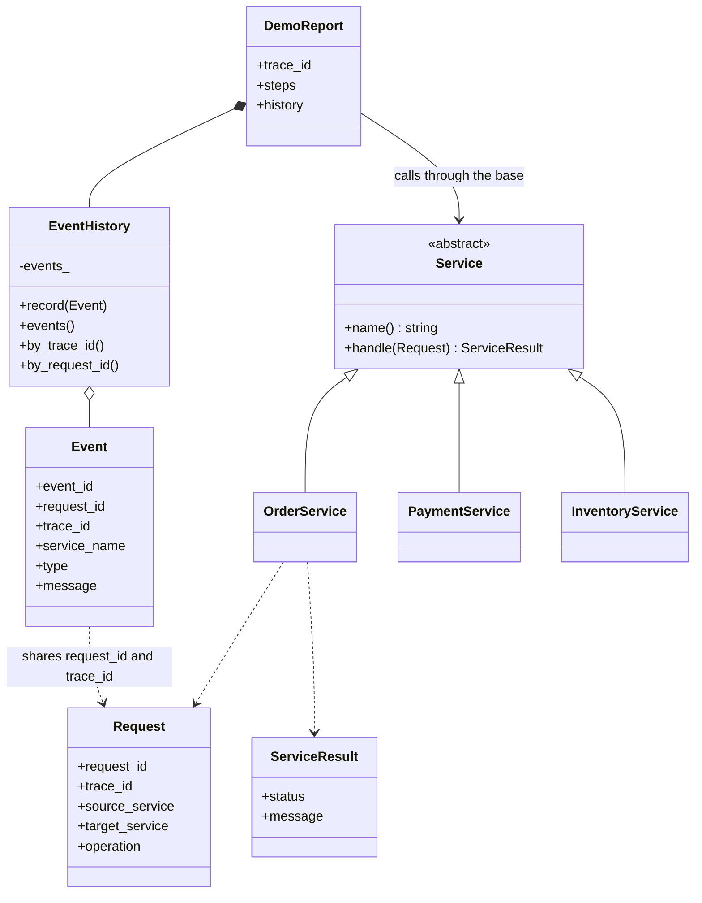
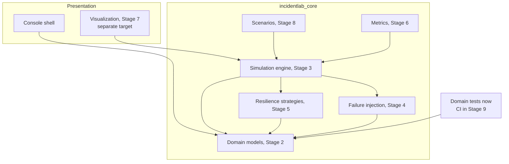

# Architecture

IncidentLab is a simulator. It models service calls and, in later stages, queues and failures inside one process. It does not deploy services, open sockets, or talk to a cloud provider.

Stage 1 fixed the dependency direction. Stage 2 adds the domain model and a fixed demonstration script. The discrete-event engine is still Stage 3.

## What exists now



| Component | Responsibility | Depends on |
| --- | --- | --- |
| `incidentlab` | Print the startup banner and the Stage 2 report. | `incidentlab::core` |
| `incidentlab_core` | Version, domain types, and the fixed demonstration script. | C++ standard library only |
| `incidentlab_tests` | Assert the domain rules and the demonstration. | `incidentlab::core` |

The library does not include `iostream` for the banner or the report. `src/main.cpp` formats `DemoReport`. A test calls `run_stage2_demo()` and reads the same struct. Neither path is required for the other.

The version number is still defined once, in `project(VERSION ...)` inside `CMakeLists.txt`.

## Dependency rule

```text
presentation  -->  incidentlab_core  -->  C++ standard library
tests         -->  incidentlab_core
```

Nothing in the core depends on the console, on raylib, or on the test harness.

## Stage 2 class model



### Inheritance

`OrderService`, `PaymentService`, and `InventoryService` inherit from `Service`. Each accepts one operation and rejects every other operation with `ServiceStatus::Rejected`. The base declares the contract. The derived classes supply the behavior.

`Service` deletes copying and moving so a service cannot be sliced into a base value.

### Runtime polymorphism

`run_stage2_demo()` stores the three services in a `Service*` array and calls `handle()` through that pointer. The caller does not switch on the service name. The dynamic type selects `OrderService::handle`, `PaymentService::handle`, or `InventoryService::handle`.

### Composition

`DemoReport` has an `EventHistory`. `EventHistory` has a `std::vector<Event>`. The history is a part of the report, not a parent class. The vector is private. `record()` appends. `events()`, `by_trace_id()`, and `by_request_id()` only read. Filters use `std::copy_if` and keep insertion order.

### Request and Event

Both are value types. A constructor checks the required strings and throws `std::invalid_argument` when one is empty. After that, the fields are public so call sites stay readable. There are no getters and setters.

An unsupported operation does not throw. `handle()` returns `ServiceResult` with `ServiceStatus::Rejected`. Exceptions are for a request or event that was never valid. A rejected operation is a normal result.

`source_service` may be empty. The other request strings may not. An event message may be empty. The event id, request id, trace id, and service name may not.

### Correlation

`request_id` names one call. `trace_id` names the workflow that call belongs to. The demonstration uses `TRACE-001` for `REQ-001`, `REQ-002`, and `REQ-003`. `EventHistory::by_trace_id("TRACE-001")` returns every event from that workflow. `by_request_id` returns the events of one call.

Event ids in the demonstration are `EVT-001` onward, allocated by a counter. The same script produces the same ids. There is no clock and no random source.

### What the demonstration is

`run_stage2_demo()` is a fixed script: create the trace, call the three services, store six events. It is not a scheduler. Stage 3 can delete `stage2_demo.hpp` and `stage2_demo.cpp` without changing `Service`, `Request`, or `Event`.

## How later stages plug in



| Stage | Where it will land | Role |
| --- | --- | --- |
| 2 | `include/incidentlab/`, `src/`, `tests/` | Requests, services, events, history, and the fixed demo. Present now. |
| 3 | `include/incidentlab/simulation/`, `src/simulation/` | Schedule calls. No drawing. Replaces the fixed script. |
| 4 | failure policies the engine consults | Timeouts, crashes, slow calls, dropped messages. |
| 5 | strategies composed into callers | Retry and circuit breaker. |
| 6 | metrics the engine records | Counters and health. The UI only reads them. |
| 7 | a separate `incidentlab_viz` target | raylib. It links `incidentlab::core` and contains no simulation rules. |
| 8 | scenario definitions | The same workload under two strategies. |
| 9 | GoogleTest, if vendored without a network fetch, and `.github/workflows/` | Broader tests and CI. |
| 10 | release notes and a license | Portfolio write-up. |

The Stage 2 tests are an executable with assertions, registered with CTest. GoogleTest is not downloaded. A build must succeed with no network access.

## Separation of concerns

- **Domain** answers what a request, a service, and an event are.
- **The Stage 2 script** answers what one fixed trace does. It is not the simulation.
- **Presentation** prints the banner and the report.
- **Tests** call the core directly. They do not start from `main()`.

## Decisions

- Three service classes, not one class configured with strings. The accepted operation and the success text already differ, and later stages can change one service without editing the others. The virtual call is the extension point.
- No gateway, queue, database, retry, circuit breaker, clock, or metric registry in this stage. Those need a scheduler or a failure model that does not exist yet.
- `Service` is non-copyable. The demo keeps concrete services on the stack and passes `Service&`.
- Event ids are formatted in the demo, not inside `Event`. `Event` only checks that the id it was given is non-empty.
