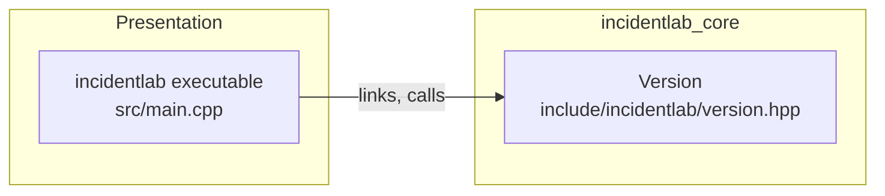
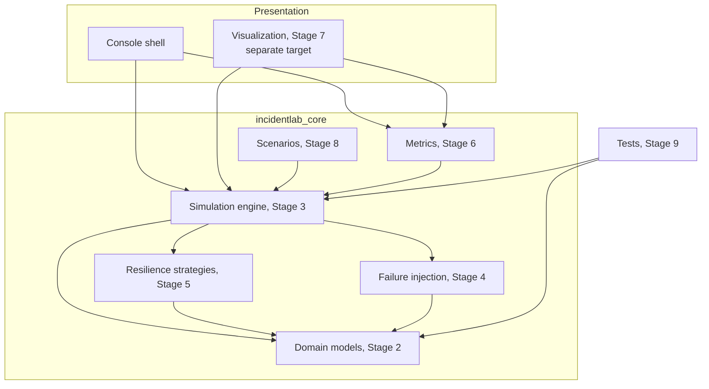

# Architecture

IncidentLab is a simulator. It models service calls, queues, and failures inside one process. It does not deploy services, open sockets, or talk to a cloud provider.

Stage 1 puts the dependency direction in place and stops there. The simulation itself starts in Stage 2.

## What exists now



| Component | Responsibility | Depends on |
| --- | --- | --- |
| `incidentlab` | Print the startup banner and return a process status. This is the presentation shell. | `incidentlab::core` |
| `incidentlab_core` | Own reusable logic. Today that is only the build version. From Stage 2 it owns the simulation. | C++ standard library only |

The arrow points one way. The library does not include `iostream`, does not print the banner, and does not know which executable called it. A future window, a test, or another tool can link the same library.

The version number is defined once, in `project(VERSION ...)` inside `CMakeLists.txt`. The build injects it into `src/version.cpp`. The header only exposes `current_version()` and `version_string()`.

## Dependency rule

```text
presentation  -->  incidentlab_core  -->  C++ standard library
tests         -->  incidentlab_core
```

Nothing in the core may depend on the console, on raylib, or on a test framework. That rule is what keeps the engine runnable without a GUI.

## How later stages plug in

The same library grows. New code is added as focused types behind the existing target. `src/main.cpp` stays a shell: it will ask the engine to run and then display the result. It will not decide how a payment call fails.



Planned homes, not created yet:

| Stage | Added under | Role |
| --- | --- | --- |
| 2 | `include/incidentlab/domain/`, `src/domain/` | Requests, events, services, the in-memory queue and stores. Value types and small classes. |
| 3 | `include/incidentlab/simulation/`, `src/simulation/` | Drive one scenario forward. No drawing. |
| 4 | failure policies used by the engine | Timeouts, crashes, slow calls, dropped messages. The engine asks a policy; it does not hard-code one outage. |
| 5 | resilience strategies composed into callers | Retry and circuit breaker as interchangeable behavior, held by composition. |
| 6 | metrics read by presentation | Counters and health. The engine records them. The UI only reads them. |
| 7 | a separate `incidentlab_viz` target | raylib drawing. It links `incidentlab::core` and contains no simulation rules. |
| 8 | scenario definitions | Run the same workload under two strategies and compare the metrics. |
| 9 | `tests/`, `.github/workflows/` | GoogleTest against the library. The workflow builds Debug and Release. |
| 10 | user-facing docs and a release | Portfolio write-up. No new runtime behavior required for the architecture. |

Directories `tests/`, `assets/`, and `.github/workflows/` are omitted on purpose until those stages. Git does not track empty folders, and empty placeholders would look like unfinished features.

## Separation of concerns

- **Domain** answers "what exists": a service, a request, a queue message.
- **Simulation** answers "what happens next" when a request is submitted or a failure is injected.
- **Infrastructure**, when a seam is actually needed, answers "where time and chance come from" (a clock, a random source). Those will be small types inside the core, not a network or a database server.
- **Presentation** answers "what the user sees". Console now, drawing in Stage 7.
- **Tests** call the core directly. They do not launch the window.

## OOP, applied only where it pays off

Stage 1 has no class hierarchy. `Version` is an aggregate of three integers because it has nothing to hide. Inheritance starts when two types share a contract and differ in behavior.

The shapes that fit later stages:

- **Encapsulation.** A circuit breaker's failure count stays private. Callers see `allow_call()` and `record_result()`, not the counter.
- **Abstraction.** The engine depends on a failure policy, not on a specific outage.
- **Inheritance and polymorphism.** A service contract such as "handle this request" can have order, payment, and inventory implementations. The engine stores them by that contract.
- **Composition.** The API gateway *has* routes and a caller. It is not a subclass of every service it talks to. A caller *has* a retry policy and a circuit breaker.
- **Exceptions.** A failed step that the simulation cannot continue (unknown service, broken scenario file) is reported with an exception and a clear message. Ordinary simulated failures, such as a declined payment, are results, not exceptions.
- **STL.** `std::vector`, `std::deque`, and `std::unordered_map` hold services, the event queue, and metrics. No hand-written containers.

SOLID follows the same restraint. A single-purpose type (S), a call site that depends on a policy rather than a concrete outage (D), and extension by a new policy instead of editing the engine (O) matter once those types exist. They are not introduced as empty base classes in Stage 1.

## What the core library is for

`incidentlab_core` is a static library. It has no `main`. The executable `incidentlab` links it and is the only thing you run.

That split is the extension point:

- Stage 7 can add a second executable for the window without copying the engine.
- Stage 9 can link tests to the library without starting the console program.
- The console program can stay small enough to read in one sitting.
