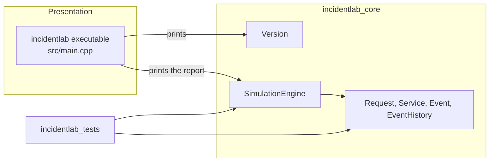
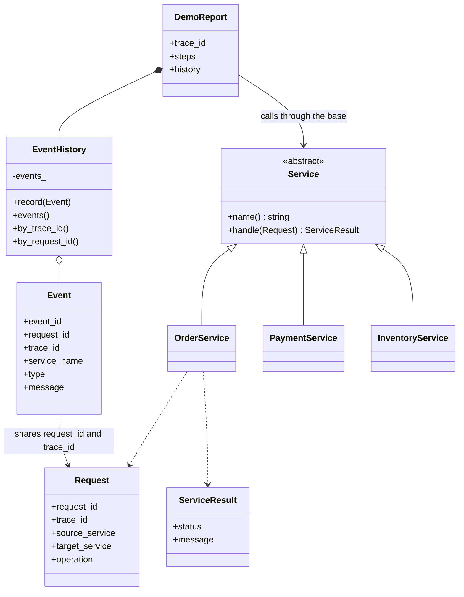
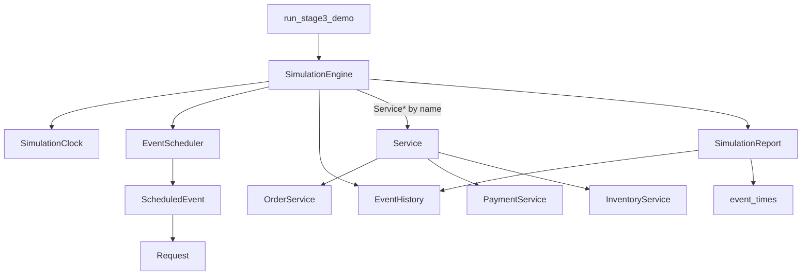
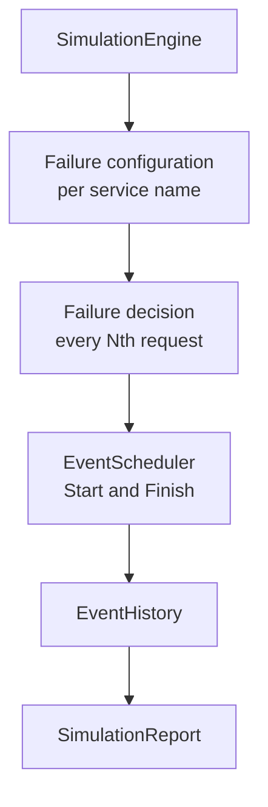
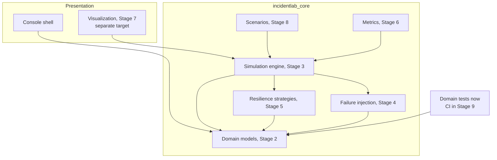

# Architecture

IncidentLab is a simulator. It models service calls and, in later stages, queues and failures inside one process. It does not deploy services, open sockets, or talk to a cloud provider.

Stage 1 fixed the dependency direction. Stage 2 added the domain model. Stage 3 runs that model on a virtual clock. Stage 4 injects deterministic failures. Retries are still Stage 5.

## What exists now



| Component | Responsibility | Depends on |
| --- | --- | --- |
| `incidentlab` | Print the startup banner and the Stage 3 report. | `incidentlab::core` |
| `incidentlab_core` | Version, domain types, the Stage 2 script, and the simulation engine. | C++ standard library only |
| `incidentlab_tests` | Assert the domain rules and the simulation. | `incidentlab::core` |

The library does not include `iostream`. `src/main.cpp` formats `SimulationReport`. Tests call the engine and `run_stage2_demo()` directly.

The version number is still defined once, in `project(VERSION ...)` inside `CMakeLists.txt`.

## Dependency rule

```text
presentation  -->  incidentlab_core  -->  C++ standard library
tests         -->  incidentlab_core
```

Nothing in the core depends on the console, on raylib, or on the test harness.

## Stage 2 class model



### Inheritance

`OrderService`, `PaymentService`, and `InventoryService` inherit from `Service`. Each accepts one operation and rejects every other operation with `ServiceStatus::Rejected`. The base declares the contract. The derived classes supply the behavior.

`Service` deletes copying and moving so a service cannot be sliced into a base value.

### Runtime polymorphism

`run_stage2_demo()` stores the three services in a `Service*` array and calls `handle()` through that pointer. The caller does not switch on the service name. The dynamic type selects `OrderService::handle`, `PaymentService::handle`, or `InventoryService::handle`.

### Composition

`DemoReport` has an `EventHistory`. `EventHistory` has a `std::vector<Event>`. The history is a part of the report, not a parent class. The vector is private. `record()` appends. `events()`, `by_trace_id()`, and `by_request_id()` only read. Filters use `std::copy_if` and keep insertion order.

### Request and Event

Both are value types. A constructor checks the required strings and throws `std::invalid_argument` when one is empty. After that, the fields are public so call sites stay readable. There are no getters and setters.

An unsupported operation does not throw. `handle()` returns `ServiceResult` with `ServiceStatus::Rejected`. Exceptions are for a request or event that was never valid. A rejected operation is a normal result.

`source_service` may be empty. The other request strings may not. An event message may be empty. The event id, request id, trace id, and service name may not.

### Correlation

`request_id` names one call. `trace_id` names the workflow that call belongs to. The demonstration uses `TRACE-001` for `REQ-001`, `REQ-002`, and `REQ-003`. `EventHistory::by_trace_id("TRACE-001")` returns every event from that workflow. `by_request_id` returns the events of one call.

Event ids in the demonstration are `EVT-001` onward, allocated by a counter. The same script produces the same ids. There is no clock and no random source.

### What the demonstration is

`run_stage2_demo()` remains a fixed script for the original domain tests. The console now calls `run_stage3_demo()`, which schedules the same three services and lets `SimulationEngine` order them.

## Discrete-event engine

Virtual time is a number the engine owns. It is not the operating-system clock. The engine never sleeps. It looks at the next `ScheduledEvent` and, only after that request is fully recorded, removes it and sets the clock to that event's time. A 50 ms gap costs one assignment.



| Type | Owns | Does not own |
| --- | --- | --- |
| `SimulationClock` | The current virtual millisecond. | The scheduler. |
| `ScheduledEvent` | A time, a sequence number, and a `Request` copy. | A callback. |
| `EventScheduler` | The pending queue and the next sequence number. | The clock. The engine passes `now`. |
| `SimulationEngine` | The clock, the scheduler, the history, timestamps, and execution records. | The `Service` objects. It stores `Service*`. |
| `SimulationReport` | A snapshot copied from the engine at one moment. | A second log that keeps growing. |

`register_service(Service&)` inserts the pointer into `std::unordered_map` under `service.name()`. A second registration of the same name throws `std::invalid_argument`. The pointed-to service must outlive every `run` or `run_next` that might call it. The engine does not delete it.

Routing reads `request.target_service` and finds that map entry. `handle()` is virtual, so `OrderService`, `PaymentService`, and `InventoryService` are selected by the dynamic type. There is no switch on the class. A missing name does not stop the run: the engine records `RequestReceived`, then `RequestRejected` with `Unknown service: <name>`.

For each executed request the history gains two `Event` values, and `event_times` gains the same virtual time twice. `Event` itself has no time field, so Stage 2 code is unchanged. The report copies `history` and `event_times` together. Index `i` in both refers to the same fact.

`std::priority_queue` is a max-heap. The comparator treats a later time, then a larger sequence number, as smaller, so `top()` is the earliest insertion. Scheduling and pop are O(log N). Service lookup is O(1) on average. Processing N queued requests is O(N log N). The sequence counter is `uint64_t`. The scheduler throws `std::overflow_error` before the counter would wrap and scramble equal-time order.

`run_next(max_requests)` finishes at most that many requests. A start whose outcome is recorded later does not count as finished. Zero executes none. `run()` drains every start and finish action. Time and history stay as they are between calls.

A zero-delay outcome is recorded before the engine reads the next queued action, so Stage 3 order is unchanged. A later outcome is a `Finish` action on the same queue. If `handle` throws, the start stays queued, nothing new is recorded, and the exception propagates. A finish does not call `handle`. If committing it throws, the partial record is rolled back and the finish stays queued.

## Failure injection

Failures are simulated. No packet is sent, no server is contacted, and a virtual delay does not call `sleep`. Retries and circuit breakers are Stage 5. They are not in this build.



| Type | What happens | handle() |
| --- | --- | --- |
| None | The service runs and the outcome is recorded at the start time. | Called |
| ServiceFailure | The service is reached, then the request fails. | Not called |
| SlowResponse | The service runs at the start time. Success is recorded at start + delay. | Called |
| Timeout | The deadline is start + timeout. The processing delay is not waited out. | Not called |
| DroppedRequest | The request never arrives. One `RequestDropped` event is recorded at the start time. | Not called |

`configure_failure` stores the policy on the engine and resets that service's counter. `FailureType::None` removes it. The counter increments when the start is committed, in execution order, including unsupported operations. A drop does not call `handle`, but it still uses its turn so every Nth drop stays aligned. Requests that are not the Nth run normally.

`scheduled_time` is when the start runs. `completion_time` is the start plus the delay, or plus the timeout threshold. The clock advances to the action being committed and never moves backward. At one timestamp, the smaller sequence number runs first. A finish is numbered when the start is committed, so an action already queued at that time runs before it.

`pending_requests` are starts that have not run. `in_progress_requests` have started and are waiting for a finish. `processed_requests` counts only terminal outcomes: successful + rejected + failed + timed out + dropped. An in-progress request is none of those.

## How later stages plug in



| Stage | Where it will land | Role |
| --- | --- | --- |
| 2 | `include/incidentlab/`, `src/`, `tests/` | Requests, services, events, history, and the fixed demo. Present now. |
| 3 | `include/incidentlab/simulation/`, `src/simulation/` | Virtual clock, scheduler, and engine. Present now. |
| 4 | `FailureConfig` inside `SimulationEngine` | Deterministic failure injection. Present now. |
| 5 | strategies composed into callers | Retry and circuit breaker. |
| 6 | metrics the engine records | Counters and health. The UI only reads them. |
| 7 | a separate `incidentlab_viz` target | raylib. It links `incidentlab::core` and contains no simulation rules. |
| 8 | scenario definitions | The same workload under two strategies. |
| 9 | GoogleTest, if vendored without a network fetch, and `.github/workflows/` | Broader tests and CI. |
| 10 | release notes and a license | Portfolio write-up. |

The Stage 2 tests are an executable with assertions, registered with CTest. GoogleTest is not downloaded. A build must succeed with no network access.

## Separation of concerns

- **Domain** answers what a request, a service, and an event are.
- **The Stage 2 script** answers what one fixed trace does. It is not the simulation.
- **Presentation** prints the banner and the report.
- **Tests** call the core directly. They do not start from `main()`.

## Decisions

- Three service classes, not one class configured with strings. The accepted operation and the success text already differ, and later stages can change one service without editing the others. The virtual call is the extension point.
- No gateway, queue, database, retry, circuit breaker, clock, or metric registry in this stage. Those need a scheduler or a failure model that does not exist yet.
- `Service` is non-copyable. The demo keeps concrete services on the stack and passes `Service&`.
- `Service*` values in the engine are non-owning. The caller keeps the service objects alive.
- `ScheduledEvent` and `Event` stay separate. One is future work. The other is a recorded fact.
- Virtual time is a parallel vector, not a new field on `Event`, so the Stage 2 event type did not change.
