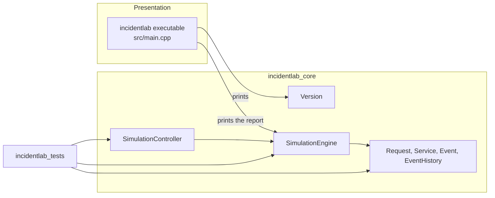
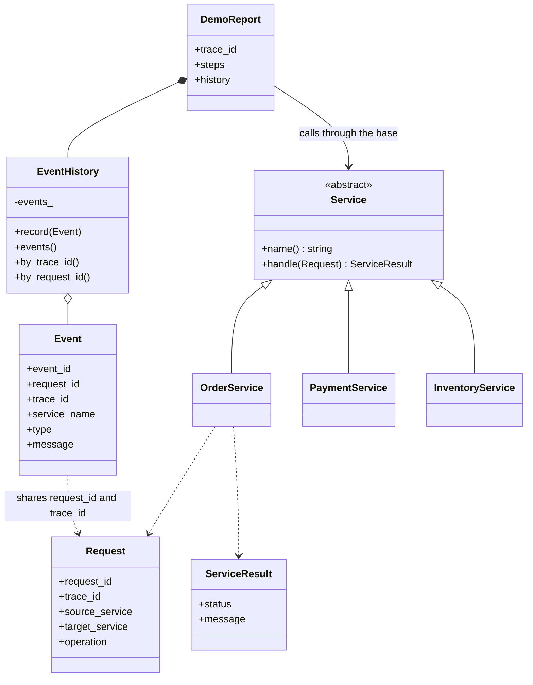
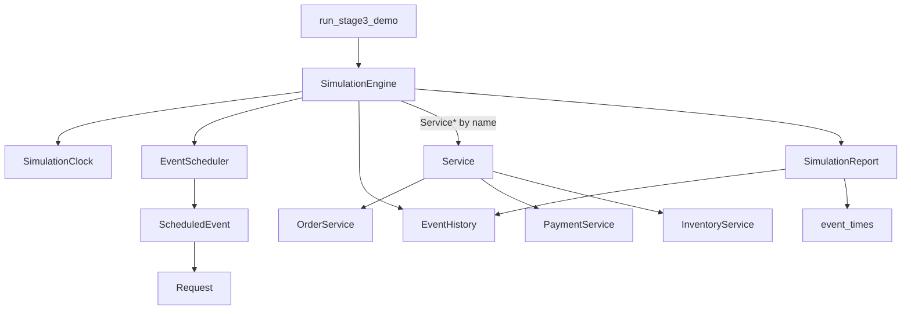
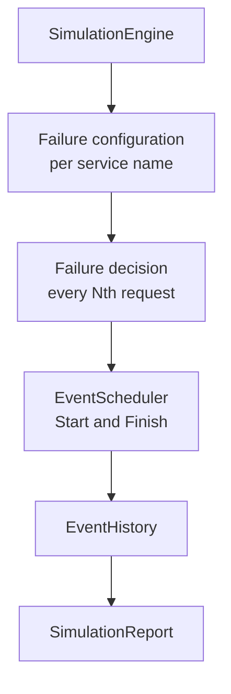
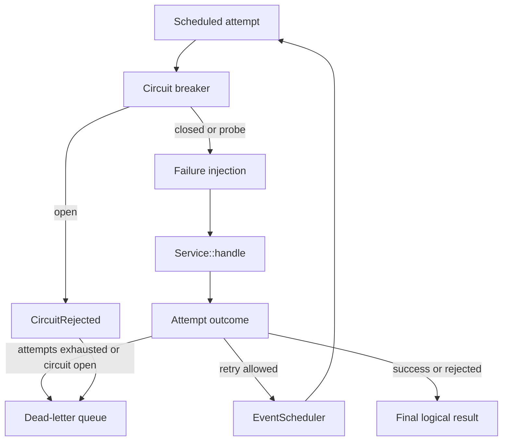
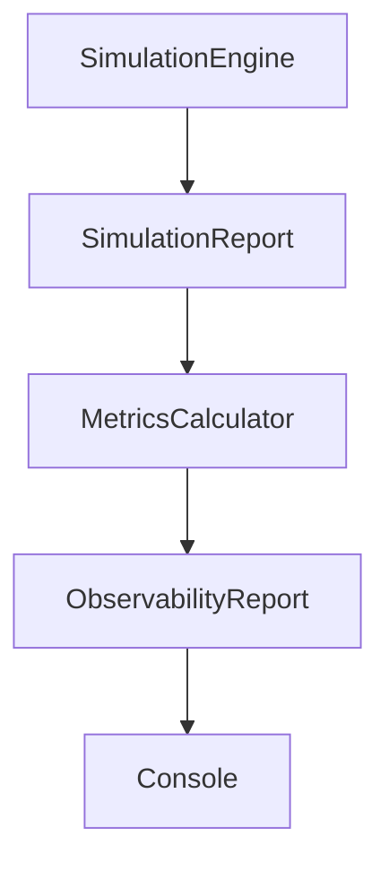
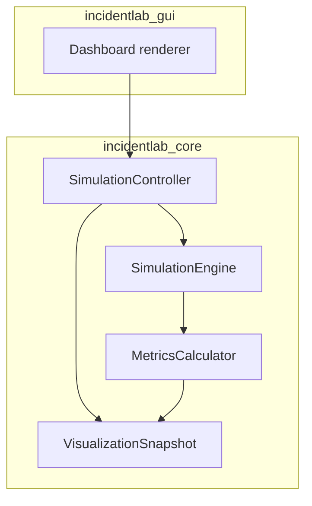
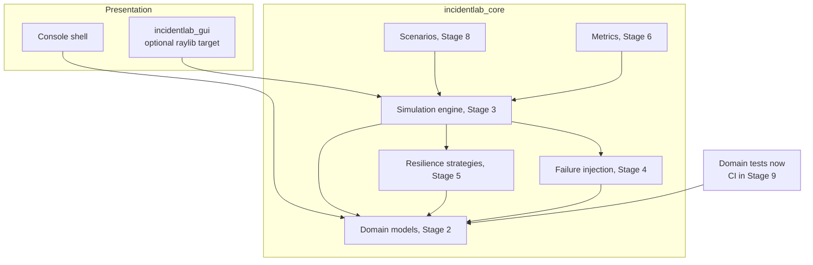

# Architecture

IncidentLab is a simulator. It models service calls and, in later stages, queues and failures inside one process. It does not deploy services, open sockets, or talk to a cloud provider.

Stage 1 fixed the dependency direction. Stage 2 added the domain model. Stage 3 runs that model on a virtual clock. Stage 4 injects deterministic failures. Stage 5 adds retry, a circuit breaker, and a dead-letter queue. Stage 6 calculates metrics from the simulation report. Stage 7 adds a controller and an optional raylib window. The core library still does not include raylib.

## What exists now



| Component | Responsibility | Depends on |
| --- | --- | --- |
| `incidentlab` | Print the startup banner and the Stage 6 metrics report. | `incidentlab::core` |
| `incidentlab_gui` | Draw the controller's snapshot. Built only when raylib is found and the option is ON. | `incidentlab::core`, raylib |
| `incidentlab_core` | Version, domain types, the engine, metrics, and the visualization controller. | C++ standard library only |
| `incidentlab_tests` | Assert the domain rules, the simulation, and the controller. No window. | `incidentlab::core` |

The library does not include `iostream`. `src/main.cpp` formats `ObservabilityReport`. Tests call the engine and the calculators directly.

The version number is still defined once, in `project(VERSION ...)` inside `CMakeLists.txt`.

## Dependency rule

```text
presentation  -->  incidentlab_core  -->  C++ standard library
tests         -->  incidentlab_core
```

Nothing in the core depends on the console, on raylib, or on the test harness.

## Stage 2 class model



### Inheritance

`OrderService`, `PaymentService`, and `InventoryService` inherit from `Service`. Each accepts one operation and rejects every other operation with `ServiceStatus::Rejected`. The base declares the contract. The derived classes supply the behavior.

`Service` deletes copying and moving so a service cannot be sliced into a base value.

### Runtime polymorphism

`run_stage2_demo()` stores the three services in a `Service*` array and calls `handle()` through that pointer. The caller does not switch on the service name. The dynamic type selects `OrderService::handle`, `PaymentService::handle`, or `InventoryService::handle`.

### Composition

`DemoReport` has an `EventHistory`. `EventHistory` has a `std::vector<Event>`. The history is a part of the report, not a parent class. The vector is private. `record()` appends. `events()`, `by_trace_id()`, and `by_request_id()` only read. Filters use `std::copy_if` and keep insertion order.

### Request and Event

Both are value types. A constructor checks the required strings and throws `std::invalid_argument` when one is empty. After that, the fields are public so call sites stay readable. There are no getters and setters.

An unsupported operation does not throw. `handle()` returns `ServiceResult` with `ServiceStatus::Rejected`. Exceptions are for a request or event that was never valid. A rejected operation is a normal result.

`source_service` may be empty. The other request strings may not. An event message may be empty. The event id, request id, trace id, and service name may not.

### Correlation

`request_id` names one call. `trace_id` names the workflow that call belongs to. The demonstration uses `TRACE-001` for `REQ-001`, `REQ-002`, and `REQ-003`. `EventHistory::by_trace_id("TRACE-001")` returns every event from that workflow. `by_request_id` returns the events of one call.

Event ids in the demonstration are `EVT-001` onward, allocated by a counter. The same script produces the same ids. There is no clock and no random source.

### What the demonstration is

`run_stage2_demo()` remains a fixed script for the original domain tests. The console now calls `run_stage3_demo()`, which schedules the same three services and lets `SimulationEngine` order them.

## Discrete-event engine

Virtual time is a number the engine owns. It is not the operating-system clock. The engine never sleeps. It looks at the next `ScheduledEvent` and, only after that request is fully recorded, removes it and sets the clock to that event's time. A 50 ms gap costs one assignment.



| Type | Owns | Does not own |
| --- | --- | --- |
| `SimulationClock` | The current virtual millisecond. | The scheduler. |
| `ScheduledEvent` | A time, a sequence number, a start or finish action, and a `Request` copy. | A callback. |
| `EventScheduler` | The pending queue and the next sequence number. | The clock. The engine passes `now`. |
| `SimulationEngine` | The clock, the scheduler, the history, timestamps, and execution records. | The `Service` objects. It stores `Service*`. |
| `SimulationReport` | A snapshot copied from the engine at one moment. | A second log that keeps growing. |

`register_service(Service&)` inserts the pointer into `std::unordered_map` under `service.name()`. A second registration of the same name throws `std::invalid_argument`. The pointed-to service must outlive every `run` or `run_next` that might call it. The engine does not delete it.

Routing reads `request.target_service` and finds that map entry. `handle()` is virtual, so `OrderService`, `PaymentService`, and `InventoryService` are selected by the dynamic type. There is no switch on the class. A missing name does not stop the run: the engine records `RequestReceived`, then `RequestRejected` with `Unknown service: <name>`.

A request that finishes at its start time adds two events at that same time. A dropped request adds only `RequestDropped`. A delayed outcome adds `RequestReceived` at the start and the outcome later. `event_times` stays aligned with that history. `Event` itself has no time field, so Stage 2 code is unchanged. The report copies `history` and `event_times` together. Index `i` in both refers to the same fact.

`std::priority_queue` is a max-heap. The comparator treats a later time, then a larger sequence number, as smaller, so `top()` is the earliest insertion. Scheduling and pop are O(log N). Service lookup is O(1) on average. Processing N queued requests is O(N log N). The sequence counter is `uint64_t`. The scheduler throws `std::overflow_error` before the counter would wrap and scramble equal-time order.

`run_next(max_requests)` finishes at most that many requests. A start whose outcome is recorded later does not count as finished. Zero executes none. `run()` drains every start and finish action. Time and history stay as they are between calls. `step_once()` runs the next Start or Finish and leaves it queued if `process` throws. `run_next` still means "finish this many logical requests," not "run one action."

A zero-delay outcome is recorded before the engine reads the next queued action, so Stage 3 order is unchanged. A later outcome is a `Finish` action on the same queue. If `handle` throws, the start stays queued, nothing new is recorded, and the exception propagates. A finish does not call `handle`. If committing it throws, the partial record is rolled back and the finish stays queued.

## Failure injection

Failures are simulated. No packet is sent, no server is contacted, and a virtual delay does not call `sleep`. Retries and circuit breakers are implemented in Stage 5.



| Type | What happens | handle() |
| --- | --- | --- |
| None | The service runs and the outcome is recorded at the start time. | Called |
| ServiceFailure | The service is reached, then the request fails. | Not called |
| SlowResponse | The service runs at the start time. Success is recorded at start + delay. | Called |
| Timeout | The deadline is start + timeout. The processing delay is not waited out. | Not called |
| DroppedRequest | The request never arrives. One `RequestDropped` event is recorded at the start time. | Not called |

`configure_failure` stores the policy on the engine and resets that service's counter. `FailureType::None` removes it. The counter increments when the start is committed, in execution order, including unsupported operations. A drop does not call `handle`, but it still uses its turn so every Nth drop stays aligned. Requests that are not the Nth run normally.

`scheduled_time` is when the start runs. `completion_time` is the start plus the delay, or plus the timeout threshold. The clock advances to the action being committed and never moves backward. At one timestamp, the smaller sequence number runs first. A finish is numbered when the start is committed, so an action already queued at that time runs before it.

`pending_requests` are starts that have not run. `in_progress_requests` have started and are waiting for a finish. `processed_requests` counts only final logical outcomes: successful + rejected + failed + timed out + dropped + circuit rejected. An in-progress request is none of those. A retry is another attempt of the same logical request, not a second processed request.

## Resilience



Retry configuration lives on the engine, keyed by service name. The delay before retry number `n` is `initial_delay_ms * multiplier^(n - 1)`. The scheduler receives that retry as a normal start action. Virtual time does not move backward, and the delay is rejected when it does not fit in the clock.

The breaker has three states. Closed counts consecutive `Failed`, `TimedOut`, and `Dropped` outcomes. `Rejected` does not count. Open blocks later attempts until `reset_timeout_ms` has passed, then one probe moves it to half-open. Other attempts wait while that probe is still in flight. The probe's result is applied when it is known: success closes the circuit, failure opens it again and restarts the timeout.

An attempt that started before the circuit opened still finishes. If the circuit is already open when that attempt's result arrives, the result does not open, close, or reset the breaker. Only a failure or success that finishes while the circuit is still closed, and the half-open probe, change it.

The dead-letter queue is used only when that service has a retry policy with at least two attempts, or a circuit breaker. A final `Failed`, `TimedOut`, `Dropped`, or `CircuitRejected` outcome is stored once, with the original request, the trace id, the number of attempts that reached the service, the virtual time, and the reason. Stage 4 runs do not write the queue. Nothing reads it back into the scheduler.

## Metrics



The calculator is read-only. It throws `std::logic_error` when the history and its timestamps differ in length, when counters disagree with the execution records, or when a completion is earlier than the logical start. Repeated calls on the same report return the same numbers.

Success rate is successful logical requests divided by completed logical requests. Failure rate uses the other completed outcomes. A retry does not add a logical request. An empty run reports 0% for both rates.

Latency is completion time minus the original start, in virtual milliseconds. Nearest-rank picks `ceil(p × n)` and uses that position in the sorted sample. P50, P95, and P99 are the fractions 50/100, 95/100, and 99/100, computed with integers so binary floating point does not change the rank.

The observation window is the earliest original start through the latest completion among completed requests. Throughput is `completed × 1000 / duration_ms`. A zero-length window, and a run with nothing completed, leave throughput empty.

Services are the names that appear in the report, sorted alphabetically. An unknown target is reported under that target name. Each service has its own outcome counts, attempt counts, latency, circuit openings, and dead-letter count.

Retry attempts are `RetryScheduled` events. Requests requiring retry are the distinct request ids on those events. Recovered requests are the ones that later succeed. Exhausted requests are the ones whose execution record says the last allowed attempt failed. `ExecutionRecord::retries_exhausted` is that fact. It is not inferred from the dead-letter queue.

`CircuitOpened`, `CircuitHalfOpened`, and `CircuitClosed` are counted per service. Blocked requests are `CircuitRejected` outcomes. The final state is the snapshot `report()` copied from the live breaker. A blocked request does not count as another opening.

Dead-letter observations keep the request id, trace id, service, status, attempt count, virtual time, and reason. They do not copy the rest of the request. The timeline copies each event with its timestamp and keeps history order. Filters for service, request id, and trace id return new vectors.

A registered service that never appears in the report is omitted. In-progress attempts count as attempts and do not count as completed latency or throughput. Percentiles are not interpolated. The queue is not replayed, and nothing is drawn on screen.

## Visualization



The renderer reads a snapshot and sends commands back to the controller: start, pause, resume, step, reset, speed, and selection. It does not call `Service::handle`, inject failures, or recompute rates. `MetricsCalculator` is unchanged and does not include a raylib header.

`VisualizationSnapshot` copies the observability report, the service rows, and the observed call edges. A test can keep that copy after the controller moves on. Selection is a service name and an event id, not a pointer.

The scenario session is one object owned by `std::unique_ptr`. Its members are the services, then the engine. Destruction destroys the engine first, while the services are still alive. Reset constructs a new session before the old one is destroyed.

`PlaybackSpeed` changes how much frame time must accumulate before the next `step_once()`. The intervals are 1 s, 0.5 s, 0.25 s, and 0.125 s. Virtual timestamps stay on the scheduler. Pause clears the accumulated frame time.

The node status is taken from the latest history and the breaker snapshot. Open wins over the last outcome. Half-open, or a received request that has not finished, is processing. Timed out and dropped stay distinct from failed. A service with no breaker stores an empty `optional`, which the window prints as `NOT CONFIGURED`.

## How later stages plug in



| Stage | Where it will land | Role |
| --- | --- | --- |
| 2 | `include/incidentlab/`, `src/`, `tests/` | Requests, services, events, history, and the fixed demo. Complete. |
| 3 | `include/incidentlab/simulation/`, `src/simulation/` | Virtual clock, scheduler, and engine. Complete. |
| 4 | `FailureConfig` inside `SimulationEngine` | Deterministic failure injection. Complete. |
| 5 | Retry, `CircuitBreaker`, and `DeadLetterQueue` inside `SimulationEngine` | Resilience patterns. Complete. |
| 6 | `MetricsCalculator` reads `SimulationReport` | Rates, latency, throughput, and the timeline. Complete. |
| 7 | `SimulationController` in the core, `incidentlab_gui` beside it | raylib draws snapshots. It links `incidentlab::core` and contains no simulation rules. Implemented, pending review. |
| 8 | scenario definitions | The same workload under two strategies. |
| 9 | GoogleTest, if vendored without a network fetch, and `.github/workflows/` | Broader tests and CI. |
| 10 | release notes and a license | Portfolio write-up. |

The Stage 2 tests are an executable with assertions, registered with CTest. GoogleTest is not downloaded. A build must succeed with no network access.

## Separation of concerns

- **Domain** answers what a request, a service, and an event are.
- **The Stage 2 script** answers what one fixed trace does. It is not the simulation.
- **Metrics** reads a finished report. It does not run the simulation or format text.
- **Presentation** prints the banner and the observability report, or draws a snapshot.
- **The controller** decides when the engine may run the next action. It does not invent outcomes.
- **Tests** call the core directly. They do not start from `main()` and they do not open a window.

## Decisions

- Three service classes, not one class configured with strings. The accepted operation and the success text already differ, and later stages can change one service without editing the others. The virtual call is the extension point.
- Stage 2 did not add a gateway, queue, database, retry, circuit breaker, clock, or metric registry. Those arrived in later stages, or are still planned.
- `Service` is non-copyable. The demo keeps concrete services on the stack and passes `Service&`.
- `Service*` values in the engine are non-owning. The caller keeps the service objects alive.
- `ScheduledEvent` and `Event` stay separate. One is future work. The other is a recorded fact.
- Virtual time is a parallel vector, not a new field on `Event`, so the Stage 2 event type did not change.
