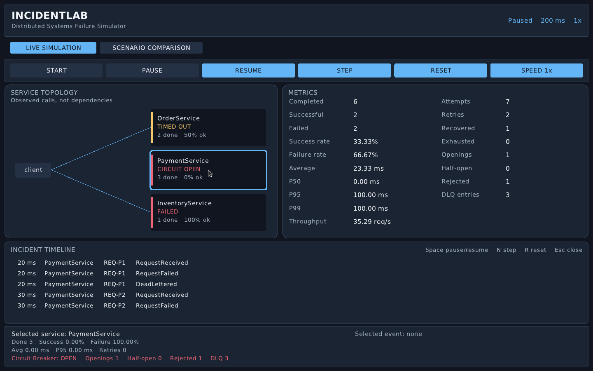

# User guide

IncidentLab has a console executable and an optional window. Both read the core library. Neither talks to a network.

## Console

From a Debug build:

```bash
./build/debug/incidentlab
./build/debug/incidentlab --compare
```

`incidentlab` with no arguments prints the version line and the Stage 6 metrics report. The version string comes from `project(VERSION)` in `CMakeLists.txt`. The current value is `1.0.0`. The window does not display a version. The number is not a published release tag.

`incidentlab --compare` prints only the Stage 8 comparison. It does not also print the Stage 6 report.

No other flag is defined. Any other argument is ignored, and the program prints the Stage 6 report. There is no interactive prompt.

### Stage 6 report

The report is one fixed scenario, trace `TRACE-STAGE6`, calculated by `MetricsCalculator` after the engine finishes. The tests lock these global results:

| Metric | Value |
| --- | ---: |
| Completed | 8 |
| Successful | 4 |
| Failed | 3 |
| Circuit rejections | 1 |
| Success rate | 50% |
| Failure rate | 50% |
| Total attempts | 9 |
| Retry attempts | 2 |
| Recovered after retry | 1 |
| Exhausted retries | 1 |
| Average latency | 25 ms |
| P50 / P95 / P99 | 0 / 100 / 100 ms |
| Throughput | 8 requests/second |
| Circuit openings | 1 |
| Dead-lettered requests | 4 |

Order requests succeed. Inventory retries. Payment opens and later closes its circuit. The timeline lists every recorded event with its virtual timestamp, service, request id, trace id, and event type.

### Stage 8 comparison

`--compare` prints a table for Baseline, Retry Only, Circuit Breaker, and Full Resilience, then the Baseline differences and a few observations. The locked success rates are 40%, 70%, 30%, and 40%. The differences are +30, −10, and +0 percentage points. When a success-rate baseline is 0, the console prints the relative success-rate change as unavailable. On this workload the baseline success rate is 40%, so the relative lines are numbers.

## GUI

Build `incidentlab_gui` with the instructions in [build-guide.md](build-guide.md), then:

```bash
./build/gui/incidentlab_gui
```

The window opens at 1440×900 in Live Simulation. It can be resized. The minimum size is 1024×700.

### Live controls

| Control | Effect |
| --- | --- |
| START | From Ready, moves to Running. It does not by itself execute a request. |
| PAUSE | From Running, moves to Paused. |
| RESUME | From Paused, moves to Running. |
| STEP | Runs one scheduler action. From Ready, the controller ends that step Paused. |
| RESET | Restores the visualization scenario and returns to Ready at 0 ms. |
| SPEED | Cycles 0.5×, 1×, 2×, and 4×. This changes frame time, not virtual timestamps. |

Keyboard: Space starts, pauses, or resumes. N steps. R resets. Escape closes the window.

The topology shows `client` and the three services. The lines are observed calls, not a dependency graph declared in advance. Click a service node to select it. Click empty topology space to clear the selection. The footer then shows that service's completed count, rates, latency, retries, breaker state, rejections, and dead letters. If the service has no completed activity, the footer says so.

The timeline is chronological. Click a visible row to select that event. The wheel scrolls the timeline when the pointer is over it.

The metrics panel is the global snapshot: completed, successful, failed, rates, latency, throughput, attempts, retries, circuit openings, rejections, and dead-letter entries. Throughput is `N/A` when the calculator leaves it empty.

The live scenario is not the Stage 6 console scenario. Order deliveries time out on every second match. Payment uses a circuit breaker with threshold 2 and a 500 ms reset. Inventory uses retry with two attempts and a 100 ms delay. Trace id is `TRACE-VIZ`.



### Scenario comparison mode

The button under the title switches to Scenario Comparison. The live controller is not reset and is not stepped while that mode is visible. Switching back shows the same live state.

The comparison view has four scenario buttons, a reliability bar chart, a metric table, and the Baseline delta for the selected scenario. RERUN runs the four scenarios again. They are deterministic, so the numbers do not change. The default selection is Full Resilience. The success-rate difference is in percentage points.

The table shows success rate, failure rate, average latency, P95, throughput, attempts, retry attempts, recovered requests, circuit rejections, and dead-letter entries. Completed, successful, and failed counts are in the console comparison and in the tests. They are not separate rows in the window.

## Reading the metrics

Definitions match `MetricsCalculator`.

| Metric | Meaning |
| --- | --- |
| Completed | Logical requests that reached a terminal status. Pending and in-progress work is excluded. |
| Successful | Terminal status `Success`. |
| Failed | Terminal status `Failed` only. |
| Success rate | `successful / completed`, as a percent. Zero when nothing completed. |
| Failure rate | `(completed - successful) / completed`. This includes failed, rejected, timed out, dropped, and circuit-rejected requests. |
| Retry attempts | `RetryScheduled` events. This is not the total number of starts. |
| Circuit rejections | Attempts blocked while the breaker was open, or while a probe was already in flight. |
| DLQ entries | Logical requests stored because a terminal failure happened on a service that has retry or a breaker. |
| Average latency | Mean of terminal latency. Latency includes backoff. |
| P50, P95, P99 | Nearest-rank percentiles of that same sample. |
| Throughput | Completed requests per second across the window from the earliest original start to the latest completion. Empty when the window is empty or has zero duration. |

Completed is the sum of successful, rejected, failed, timed out, dropped, and circuit-rejected requests. It is not `successful + failed + circuit rejected` unless the other categories happen to be zero.

## How to read a comparison

Use Baseline as the control. Then read the other columns as a change in mechanism, not as a different workload.

- More retries can complete calls that failed on the first attempt. They also add attempts and usually add latency.
- A lower average latency can mean a call was rejected immediately instead of being served.
- A circuit rejection is a completed unsuccessful request. It is not a success and it is not counted as a service attempt.
- A dead-letter entry keeps the request id and trace id of a terminal failure. The simulator does not replay that entry.
- The strategy with the highest success rate is not automatically the one with the lowest latency. On this workload, Retry Only raises successes from 4 to 7 and average latency from 20 ms to 92 ms. Full Resilience stays at 4 successes.
